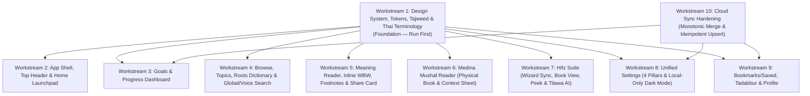

# Master Design & Feature Alignment Plan (`thai-quran-web` → `thai-quran-app`)

> [!IMPORTANT]
> **Canonical Source of Truth**: [`thai-quran-web`](file:///Users/admin/Documents/gits/thai-quran-web) (`main` branch, commit `f9d9669`) and its strict Anti-AI Editorial Manuscript standard ([`docs/DESIGN_STANDARDS.md`](file:///Users/admin/Documents/gits/thai-quran-web/docs/DESIGN_STANDARDS.md) & [`src/app/globals.css`](file:///Users/admin/Documents/gits/thai-quran-web/src/app/globals.css)).
> **Target Repository**: [`thai-quran-app`](file:///Users/admin/Documents/gits/thai-quran-app) (`main` branch, commit `61924b2`).

---

## 🧭 Executive Diagnosis: Why `thai-quran-app` Looks Out-of-Sync & "AI-Generated"

While `thai-quran-web` underwent 16 phases of **Anti-AI Editorial Manuscript** refinement in November 2026, `thai-quran-app` stopped at its late-October M3 redesign (`oct2026-improve-plan.md`). Specifically:

1. **Out-of-Sync Theme & Color Palette ([`lib/theme/app_theme.dart`](file:///Users/admin/Documents/gits/thai-quran-app/lib/theme/app_theme.dart))**:
   - **Light Mode**: App uses olive-grey `#F5F4EE` instead of Warm Parchment `#FBF9F5`, cyan-teal `#0E5B59` instead of Deep Manuscript Jade `#0E5A4A`, saturated dark teal `#123B3C` for body/heading text instead of Deep Charcoal Ink `#1C2520`, and lacks dedicated `mushafGold` (`#8A6530`) and `textMuted` (`#708078`) tokens.
   - **Dark Mode**: App sets `accent: Color(0xFF78BD8C)` (mint green!) instead of Antique Gold `#CCA252`, `primary: Color(0xFF529665)` instead of Sage Jade `#4A9E89`, and removes card borders (`BorderSide.none`).
2. **Forbidden AI Visual Clichés Across 20+ Files**:
   - Hardcoded Material/Tailwind blues (`#2196F3`, `Colors.blueGrey`), neon greens (`#15803D`, `Colors.green`, `Colors.teal`), oranges (`#FFA726`, `#B45309`), and cool Tailwind slates (`#0F172A`, `#1E293B`).
   - 7 `LinearGradient` banners (`#062C2B` → `#0E5A4A`) and heavy colored `BoxShadow`s where Web uses grounded solid `#0E5A4A` or `#FFFFFF` surfaces with `1px solid #E8E3D7` borders.
   - Puffy `BorderRadius.circular(20)` to `28` (`AppTheme.radius = 20.0`) instead of Web's crisp `12.0` (`rounded-xl`).
   - **120+ occurrences of `FontWeight.w900` and `FontWeight.w800`** on Thai typography, causing Thai upper/lower vowel and tone marks (สระและวรรณยุกต์) to collide.
3. **3 Conflicting Tajweed Palettes**:
   - `tajweed_text.dart`, `tajweed_color_guide_sheet.dart`, and `mushaf_reader_screen.dart` use 3 different neon/primary color sets instead of Web's unified muted 6-hue editorial palette ([`tajweedService.ts`](file:///Users/admin/Documents/gits/thai-quran-web/src/services/tajweedService.ts)).
4. **Major Feature & UX Gaps**:
   - **Meaning Reader**: Missing Continuous Vertical Scroll mode (`ต่อเนื่อง` vs `ทีละอายะฮฺ`), Surah Master Header Card (`nameAr` calligraphy, Play Full Surah, Open Medina Mushaf button), Inline Word-by-Word strip with Tajweed colors, Docked Inline Footnotes, Academic Errata / Restored Ayat badges, and Styled Verse Share Card (`quran-th.com` watermark).
   - **Medina Mushaf Reader & Hifz Mushaf View**: Missing physical book paper sheet (`#FFFDF9` / `#1E1E1E`), central book spine/gutter, 2-page spread on tablet/landscape, single-tap verse selection + full Verse Detail Context Sheet, and tap-to-peek toggle on hidden Hifz verses.
   - **Goals Dashboard**: Missing the 4 KPI Overview Cards, Khatam Pacing Calculator, 114-Surah Completion Matrix, Continue Reading card, 5s Archive Undo Toast, and clean divider-row `GoalRow` layout.
   - **Hifz Engine & Wizard**: Missing tab-to-tab Surah/verse/page selection sync & persistence, Wasl connected-verse recitation, Pause-Aware Stale Buffer Auto-Clear (~960ms), 1-Click Retry (`ล้าง/ลองใหม่`), Audio Guide Feedback Protection (auto-pausing mic when model reciter plays), and `nameAr` calligraphy on 114 Surah cards.
   - **Settings & Sync**: App still syncs `is_dark_mode` to Supabase (overwriting device-local dark mode!), lacks monotonic `Math.max(local, remote)` progress reconciliation on Mushaf and Meaning profiles, and has a broken Guest experience in Private Tadabbur.

---

## 🗺️ Parallel Agent Architecture & Dependency Graph

> [!TIP]
> **How Other Agents Should Use This Plan**:
> - **Workstream 1** updates [`lib/theme/app_theme.dart`](file:///Users/admin/Documents/gits/thai-quran-app/lib/theme/app_theme.dart), Tajweed palette helpers, and [`lib/shared/localization.dart`](file:///Users/admin/Documents/gits/thai-quran-app/lib/shared/localization.dart). Run **Workstream 1 first** (or merge it first) so all screen agents inherit the exact tokens and `AppTheme.radius = 12.0`.
> - **Workstreams 2 through 10** touch disjoint screen/provider files and can be assigned to parallel subagents or executed sequentially phase-by-phase.
> - Notice in [`thai-quran-app/AGENTS.md`](file:///Users/admin/Documents/gits/thai-quran-app/AGENTS.md): Update the outdated rule `BorderRadius.circular(16) or 24` in `thai-quran-app/AGENTS.md` to match `thai-quran-web/AGENTS.md` (`12px` / `rounded-xl`, strict Anti-AI palette, no `w900`).

---

## 🛠️ Detailed Agent Workstreams

---

### Workstream 1: Global Design System, Anti-AI Token Alignment, Tajweed Palette & Thai Terminology ✅ [COMPLETED]
**Owner Role**: `Design System & Typography Agent`
**Web Reference**:
- [`thai-quran-web/docs/DESIGN_STANDARDS.md`](file:///Users/admin/Documents/gits/thai-quran-web/docs/DESIGN_STANDARDS.md)
- [`thai-quran-web/src/app/globals.css`](file:///Users/admin/Documents/gits/thai-quran-web/src/app/globals.css#L1-L266)
- [`thai-quran-web/src/services/tajweedService.ts`](file:///Users/admin/Documents/gits/thai-quran-web/src/services/tajweedService.ts#L336-L373)
- [`thai-quran-web/docs/THAI_ISLAMIC_TERMINOLOGY_STANDARDS.md`](file:///Users/admin/Documents/gits/thai-quran-web/docs/THAI_ISLAMIC_TERMINOLOGY_STANDARDS.md)

#### Tasks:
1. **Update [`lib/theme/app_theme.dart`](file:///Users/admin/Documents/gits/thai-quran-app/lib/theme/app_theme.dart)**:
   - Change `static const radius = 20.0;` (line 84) to **`static const radius = 12.0;`** (`rounded-xl`), and add `static const radiusSm = 8.0;` (`rounded-lg`) and `static const radiusLg = 16.0;` (`rounded-2xl` for Mushaf book spread outer frame only).
   - Expand `AppThemeColors` with missing semantic tokens and exact hexes from `globals.css`:
     - **Light Mode (`isDark: false`)**:
       - `background`: `Color(0xFFFBF9F5)` (was `0xFFF5F4EE`)
       - `surface`: `Color(0xFFFFFFFF)` (was `0xFFFFFDF9`)
       - `surfaceMuted`: `Color(0xFFF7F5EE)` (was `0xFFEEEEE7`)
       - `borderSoft`: `Color(0xFFE8E3D7)` (was `0xFFD9DDD4`)
       - `textStrong`: `Color(0xFF1C2520)` (was `0xFF123B3C`)
       - `foreground` (`textBody`): `Color(0xFF42524A)` (was `0xFF3F4F4A`)
       - `textMuted`: `Color(0xFF708078)` (**new field**)
       - `textInverse`: `Color(0xFFFFFFFF)`
       - `primary`: `Color(0xFF0E5A4A)` (was `0xFF0E5B59`)
       - `primaryHover`: `Color(0xFF0A4437)` (was `0xFF084645`)
       - `primaryLight`: `Color(0xFFEAF2EE)` (was `0xFFE3EFEB`)
       - `primaryLightBorder`: `Color(0xFFB7D4C7)` (was `0xFFC3D9D1`)
       - `mushafGold` / `accent`: `Color(0xFF8A6530)` (was `0xFFC59A52`)
       - `mushafGoldHover`: `Color(0xFF735424)` (**new field**)
       - `mushafGoldSoft`: `Color(0xFFF6EFE3)` (**new field**)
       - `mushafGoldBorder`: `Color(0xFFD7C299)` (**new field**)
       - `success`: `Color(0xFF296455)`, `warning`: `Color(0xFF8A6530)`, `danger`: `Color(0xFFA34C43)` (`dangerSoft`: `Color(0xFFFAF0EE)`)
     - **Dark Mode (`isDark: true`)**:
       - `background`: `Color(0xFF131210)` (or `#121212`)
       - `surface`: `Color(0xFF1C1B18)` (or `#161616`)
       - `surfaceMuted`: `Color(0xFF24231F)` (or `#1C1C1C`)
       - `borderSoft`: `Color(0xFF2E2C27)` (or `#2C2C2C`)
       - `textStrong`: `Color(0xFFFAF6EE)`
       - `foreground`: `Color(0xFFD8D4CD)`
       - `textMuted`: `Color(0xFF96928A)`
       - `textInverse`: `Color(0xFF131210)`
       - `primary`: `Color(0xFF4A9E89)` (was `0xFF529665`)
       - `primaryHover`: `Color(0xFF3B8270)`
       - `primaryLight`: `Color(0xFF162420)`
       - `primaryLightBorder`: `Color(0xFF233A33)`
       - `mushafGold` / `accent`: `Color(0xFFCCA252)` (was mint green `0xFF78BD8C`!)
       - `mushafGoldHover`: `Color(0xFFB88B39)`
       - `mushafGoldSoft`: `Color(0xFF292013)`
       - `mushafGoldBorder`: `Color(0xFF553D1E)`
       - `success`: `Color(0xFF4A9E89)`, `warning`: `Color(0xFFCCA252)`, `danger`: `Color(0xFFD97777)` (`dangerSoft`: `Color(0xFF321715)`)
   - Update `CardThemeData` (lines 151–159) and `InputDecorationTheme` (lines 180–196) to include `BorderSide(color: c.borderSoft, width: 1)` instead of `BorderSide.none`.
   - Update [`thai-quran-app/AGENTS.md`](file:///Users/admin/Documents/gits/thai-quran-app/AGENTS.md) so its design rules match `thai-quran-web/AGENTS.md`.
2. **Unify Tajweed 6-Hue Editorial Palette Across All 3 Files**:
   - Create a single canonical `TajweedPalette` helper (matching [`tajweedService.ts:336-373`](file:///Users/admin/Documents/gits/thai-quran-web/src/services/tajweedService.ts#L336-L373)):
     - `ghunnah`: Light `0xFF8A6530` / Dark `0xFFD9AB63`
     - `idgham` / `idgham_ghunnah` / `idgham_shafawi`: Light `0xFF2E6E6A` / Dark `0xFF6FB3A8`
     - `ikhfa` / `ikhfa_shafawi`: Light `0xFF3F6B3A` / Dark `0xFF8FBF7F`
     - `iqlab`: Light `0xFF7A4A6B` / Dark `0xFFC08FB4`
     - `qalqalah`: Light `0xFF4A5578` / Dark `0xFF9AA6C8`
     - `madda_normal` / `madda_permissible` / `madda_obligatory`: Light `0xFF9B3D3D` / Dark `0xFFE08A8A` (`madda_necessary`: Light `0xFF6E2A2A` / Dark `0xFFF0B4B4`)
     - `ham_wasl` / `laam_shamsiyah` / `silent` / `idgham_wo_ghunnah`: Light `0xFF8A857B` / Dark `0xFFA8A49A`
   - Apply this single palette in [`lib/widgets/tajweed_text.dart`](file:///Users/admin/Documents/gits/thai-quran-app/lib/widgets/tajweed_text.dart#L13-L43), [`lib/widgets/tajweed_color_guide_sheet.dart`](file:///Users/admin/Documents/gits/thai-quran-app/lib/widgets/tajweed_color_guide_sheet.dart#L41-L306), and [`lib/screens/mushaf_reader_screen.dart`](file:///Users/admin/Documents/gits/thai-quran-app/lib/screens/mushaf_reader_screen.dart#L3135-L3167) (fixing the bug where Mushaf collapsed Ghunnah/Ikhfa/Idgham/Iqlab into 1 green color).
3. **Global Thai Typography & Terminology Sweep**:
   - Replace all `FontWeight.w900` with `FontWeight.w700` (`bold`) and `FontWeight.w800` with `FontWeight.w700` or `FontWeight.w600` across `lib/`.
   - Standardize all Thai Islamic terms in [`lib/shared/localization.dart`](file:///Users/admin/Documents/gits/thai-quran-app/lib/shared/localization.dart) and all screen files:
     - `มุสฮัฟ` / `มุศฮัฟ` → **`มุศหัฟ`**
     - `ซูเราะฮ์` / `สูเราะฮ์` → **`ซูเราะฮฺ`**
     - `อายะฮ์` / `อายะห์` / `โองการ` → **`อายะฮฺ`**
     - `ยุซ` → **`ญุซอ์`**
     - `ตะดับบุร` → **`ตดับบุร`**

---

### Workstream 2: App Shell, Top Header & Hybrid Home Launchpad
**Owner Role**: `Home & Shell Agent`
**Web Reference**:
- [`src/components/AppShell.tsx`](file:///Users/admin/Documents/gits/thai-quran-web/src/components/AppShell.tsx)
- [`src/components/redesign/GuestLandingPage.tsx`](file:///Users/admin/Documents/gits/thai-quran-web/src/components/redesign/GuestLandingPage.tsx)
- [`src/components/home/HomeHeroBanner.tsx`](file:///Users/admin/Documents/gits/thai-quran-web/src/components/home/HomeHeroBanner.tsx)
- [`src/components/home/HomeShortcutsGallery.tsx`](file:///Users/admin/Documents/gits/thai-quran-web/src/components/home/HomeShortcutsGallery.tsx)
- [`src/components/home/HomeGoalSnapshot.tsx`](file:///Users/admin/Documents/gits/thai-quran-web/src/components/home/HomeGoalSnapshot.tsx)
**App Files**:
- [`lib/screens/welcome_screen.dart`](file:///Users/admin/Documents/gits/thai-quran-app/lib/screens/welcome_screen.dart)
- [`lib/screens/home_screen.dart`](file:///Users/admin/Documents/gits/thai-quran-app/lib/screens/home_screen.dart)

#### Tasks:
1. **Remove Artificial 4.2s Splash Delay ([`lib/screens/welcome_screen.dart`](file:///Users/admin/Documents/gits/thai-quran-app/lib/screens/welcome_screen.dart))**:
   - Transition immediately to `HomeScreen` (or render `HomeScreen` directly from `main.dart`) using Warm Parchment `#FBF9F5` / `#131210` instead of holding users on a `#0E5C59` teal splash screen for 4.2 seconds.
2. **Upgrade Top AppBar in [`lib/screens/home_screen.dart`](file:///Users/admin/Documents/gits/thai-quran-app/lib/screens/home_screen.dart#L1184-L1282)**:
   - Add **Quick Dark/Light Theme Toggle** (`Icons.wb_sunny_outlined` / `Icons.dark_mode_outlined`) directly in the Top AppBar (matching `AppShell.tsx:318-329`).
   - Add **Voice Search (`Tilawa AI`)** quick trigger in the Top AppBar / Home Launchpad alongside Global Search.
   - Make the Search button open/focus the search bar immediately.
3. **Align Hero Banner & Continue Reading Card (`_buildGreetingAndStreakCard` + `_buildUnifiedContinueHeroCard` at lines `1433-1798`)**:
   - Replace the `LinearGradient(colors: [Color(0xFF062C2B), Color(0xFF0E5A4A)])`, `BorderRadius.circular(24)`, heavy `BoxShadow`, and oversized `88px` watermark with Web's grounded **solid `#0E5A4A` container** (`BorderRadius.circular(12)`, `border: 1px solid #0A4437`).
   - Add **Contextual Time/Day Recommendation Badge (`getHomeContext`)**:
     - Friday → Surah Al-Kahf (`18`)
     - Night (`20:00–03:59`) → Surah Al-Mulk (`67`)
     - Morning (`04:00–08:59`) → Surah Ya-Sin (`36`)
     - Afternoon (`15:00–17:59`) → Surah An-Naba (`78`)
   - When user has reading history: show `อ่านต่อจากที่ค้างไว้`, mode badge (`โหมดความหมาย` or `โหมดมุศหัฟ`), Surah Arabic (`nameAr`) + Thai title + Ayah/Page, primary gold CTA (`อ่านต่อทันที →`), and a **cross-mode switch link** (`ดูความหมาย` / `เปิดหน้ามุศหัฟ`).
   - When user is new (no history): show **two side-by-side entry buttons**: `อ่านแบบความหมาย` (white button `#FFFFFF` text `#0E5A4A`) and `เปิดมุศหัฟ` (outlined/tinted button).
   - Replace hardcoded `Color(0xFF15803D)` in the 7-day streak strip with `appColors.primary` (`#0E5A4A` / `#4A9E89`).
4. **Upgrade Quick Shortcuts & Featured Surahs (`_buildQuickAccessSection` at lines `2093-2236`)**:
   - Match Web's `HomeShortcutsGallery.tsx` & `GuestLandingPage.tsx`: include authentic Uthmani Arabic calligraphy (`nameAr`), correct Al-Kahf Arabic label (`الكهف`), subtitle tags (`อ่านประจำวันศุกร์`, `ปกป้องในยามค่ำคืน`), ayah/page metadata, and easy access to both **Meaning (`ความหมาย`)** and **Mushaf (`มุศหัฟ`)** modes, plus Thematic Topic quick pills.
5. **Upgrade Invitation / Featured Ayah Card (`_buildFeaturedVerseCard` at lines `2429-2633`)**:
   - Use crisp `12px` radius and `1px solid borderSoft`.
   - Show Surah number badge (`#0E5A4A` with amber text), Ayah badge (`#F6EFE3` with `#8A6530` text), Uthmani Arabic (`28px`), full Thai translation, and an **always-visible Short Tafsir (`ตัฟซีรอัลมุคตะศ็อร`)** box on `#FAF8F4` (`surfaceMuted`) with `มุคตะศ็อร` badge (do not truncate to 2 lines by default).
6. **Upgrade Community Tadabbur Preview (`_buildCommunityReflectionsSection` at lines `2636-2824`)**:
   - Fix header spelling to `บันทึกตดับบุรจากชุมชน`.
   - Fetch 3 notes (or pool of recent notes) and add the **`สลับข้อคิดอื่น` (Shuffle)** button (`GuestLandingPage.tsx:690-699`).
   - Display the **Author name (`โดย {authorName}`)** on each reflection card alongside likes and Surah:Ayah pill.

---

### Workstream 3: Goals & Progress Dashboard (`/goals` Parity)
**Owner Role**: `Goals & Progress Agent`
**Web Reference**:
- [`src/components/goals/ModernGoalsView.tsx`](file:///Users/admin/Documents/gits/thai-quran-web/src/components/goals/ModernGoalsView.tsx)
- [`src/components/goals/GoalsDashboardOverview.tsx`](file:///Users/admin/Documents/gits/thai-quran-web/src/components/goals/GoalsDashboardOverview.tsx)
- [`src/components/goals/ContinueReadingCard.tsx`](file:///Users/admin/Documents/gits/thai-quran-web/src/components/goals/ContinueReadingCard.tsx)
- [`src/components/goals/GoalList.tsx`](file:///Users/admin/Documents/gits/thai-quran-web/src/components/goals/GoalList.tsx) & [`GoalRow.tsx`](file:///Users/admin/Documents/gits/thai-quran-web/src/components/goals/GoalRow.tsx)
- [`src/components/goals/KhatamPacingCalculator.tsx`](file:///Users/admin/Documents/gits/thai-quran-web/src/components/goals/KhatamPacingCalculator.tsx)
- [`src/components/goals/SurahCompletionMatrix.tsx`](file:///Users/admin/Documents/gits/thai-quran-web/src/components/goals/SurahCompletionMatrix.tsx)
- [`src/components/goals/ArchivedGoals.tsx`](file:///Users/admin/Documents/gits/thai-quran-web/src/components/goals/ArchivedGoals.tsx)
- [`src/components/goals/GoalDialog/GoalDialog.tsx`](file:///Users/admin/Documents/gits/thai-quran-web/src/components/goals/GoalDialog/GoalDialog.tsx)
**App File**:
- [`lib/screens/goals_screen.dart`](file:///Users/admin/Documents/gits/thai-quran-app/lib/screens/goals_screen.dart)

#### Tasks:
1. **Add 4 KPI Overview Cards at Top (`GoalsDashboardOverview.tsx`)**:
   - Display 4 crisp `rounded-xl` metric cards:
     1. **114 Surahs Completion** (`completedSurahs.length / 114` + progress bar + `%`).
     2. **Cumulative Verses Read** (`totalVersesRead / 6,236` + `%`).
     3. **Active Goals Count** (Meaning vs Mushaf breakdown).
     4. **Reading Streak / Active Days**.
2. **Add Unified `ContinueReadingCard` (`ContinueReadingCard.tsx`)**:
   - Render at the top of `GoalsScreen` showing the latest reading position across Meaning and Mushaf goals, which goal it belongs to, relative time, and a direct `อ่านต่อ →` CTA.
3. **Refactor Goal Cards into Web's Clean Single-Column `GoalList` + `GoalRow` (`GoalList.tsx`, `GoalRow.tsx`)**:
   - Hide the giant top `_buildPresetsStripCard` when the user already has active goals (only show presets in the Empty State or inside the Goal Creator Modal).
   - Only render filter tabs (`ทั้งหมด · ความหมาย · มุศหัฟ`) when both Meaning and Mushaf goals exist (`counts.meaning > 0 && counts.mushaf > 0`), styled as understated bottom-border text tabs.
   - Replace the heavy `24px`-radius individual goal cards with a unified `12px`-radius card containing divider-separated `GoalRow` items:
     - **Line 1**: `6px` semantic dot (`#0E5A4A` Meaning, `#8A6530` Mushaf) + Goal Title + `· กำลังอ่าน` + tabular percentage.
     - **Line 2**: Range subtitle.
     - **Line 3**: `6px` progress bar where **`0%` is a true empty track** (remove `.clamp(0.03, 1.0)` at lines 2289 and 2512!).
     - **Line 4**: `X จาก Y อายะฮฺ/หน้า · ถึง ...` + `อ่านต่อ` button + **`⋯` `PopupMenuButton` (`GoalOverflowMenu`)** for `แก้ไข (Edit)` and `เก็บ (Archive)`.
     - **Card Footer**: Inline `+ เพิ่มเป้าหมายใหม่` row.
4. **Add 5-Second Undo Toast on Archive (`GoalList.tsx:66-103`)**:
   - When archiving a goal, show a `SnackBar` for 5 seconds: `เก็บ "{goalName}" แล้ว` with an inline `SnackBarAction(label: 'เลิกทำ', onPressed: ...)` to restore immediately.
5. **Add Khatam Pacing & Planning Calculator (`KhatamPacingCalculator.tsx`)**:
   - Collapsible `ExpansionTile` / card (`เครื่องมือช่วยคำนวณและวางแผนอ่านคอตัม (Khatam Planner)`):
     - Mode toggle: `หน้ามุศหัฟ (604 หน้า)` vs `โหมดความหมาย (6,236 อายะฮฺ)`.
     - Duration pills: `1 เดือน (30 วัน)`, `2 เดือน (60 วัน)`, `3 เดือน (90 วัน)`, `1 ปี (365 วัน)`.
     - 3 calculated metrics: **ต่อวัน (Per day)**, **หลังละหมาด 5 เวลา (After each of 5 prayers)**, and **ญุซอ์ / วัน (Juz / day)**.
     - 1-click CTA (`ตั้งเป้าหมาย X วัน`) that opens the Goal Creator pre-filled with that plan.
6. **Add 114-Surah Completion Matrix (`SurahCompletionMatrix.tsx`)**:
   - Interactive 114-Surah grid/list inside `GoalsScreen` with filter tabs (`ทั้งหมด 114`, `อ่านจบแล้ว`, `ยังไม่อ่าน`), search bar, Uthmani calligraphy (`nameAr`), repetition badge (`อ่านแล้ว X รอบ`), 1-tap completion toggle via `ProgressProvider`, and quick jump to Meaning/Mushaf.
7. **Make Archived Goals Collapsible by Default (`ArchivedGoals.tsx`)**:
   - Replace the permanently expanded `_buildArchivedGoalsCard` (lines 2676–2846) with a collapsed-by-default accordion (`เป้าหมายที่เก็บไว้ (N)`), hidden completely when `N == 0`, with `คืนค่า` and 2-step `ยืนยันลบ?` confirmation.
8. **Streamline Goal Creator / Edit Modal (`GoalDialog.tsx`)**:
   - Hide the preset picker when editing an existing goal.
   - When creating a goal and a preset is selected, collapse the custom range fields behind a `ปรับขอบเขต ▾` toggle and display a live summary bar (`ขอบเขต: ... · X อายะฮฺ/หน้า`).
   - Include an `เก็บเข้าคลัง (Archive)` button in Edit mode.

---

### Workstream 4: Browse, Topics, Roots Dictionary & Global/Voice Search
**Owner Role**: `Discovery, Topics & Roots Agent`
**Web Reference**:
- [`src/components/redesign/BrowsePage.tsx`](file:///Users/admin/Documents/gits/thai-quran-web/src/components/redesign/BrowsePage.tsx)
- [`src/app/topics/page.tsx`](file:///Users/admin/Documents/gits/thai-quran-web/src/app/topics/page.tsx) & [`src/app/topics/[topicId]/page.tsx`](file:///Users/admin/Documents/gits/thai-quran-web/src/app/topics/%5BtopicId%5D/page.tsx)
- [`src/app/roots/page.tsx`](file:///Users/admin/Documents/gits/thai-quran-web/src/app/roots/page.tsx) & [`src/app/roots/[root]/page.tsx`](file:///Users/admin/Documents/gits/thai-quran-web/src/app/roots/%5Broot%5D/page.tsx)
- [`src/components/GlobalSearchModal.tsx`](file:///Users/admin/Documents/gits/thai-quran-web/src/components/GlobalSearchModal.tsx)
- [`src/components/VoiceSearchModal.tsx`](file:///Users/admin/Documents/gits/thai-quran-web/src/components/VoiceSearchModal.tsx)
**App Files**:
- [`lib/screens/browse_screen.dart`](file:///Users/admin/Documents/gits/thai-quran-app/lib/screens/browse_screen.dart)
- [`lib/widgets/topics_tab_view.dart`](file:///Users/admin/Documents/gits/thai-quran-app/lib/widgets/topics_tab_view.dart)
- [`lib/screens/topic_verses_screen.dart`](file:///Users/admin/Documents/gits/thai-quran-app/lib/screens/topic_verses_screen.dart)
- [`lib/screens/root_verses_screen.dart`](file:///Users/admin/Documents/gits/thai-quran-app/lib/screens/root_verses_screen.dart)
- [`lib/widgets/voice_search_sheet.dart`](file:///Users/admin/Documents/gits/thai-quran-app/lib/widgets/voice_search_sheet.dart)

#### Tasks:
1. **Upgrade Surah, Juz & 604-Page Cards in [`lib/screens/browse_screen.dart`](file:///Users/admin/Documents/gits/thai-quran-app/lib/screens/browse_screen.dart)**:
   - **Surah Cards**: Crisp `12px` radius with `1px solid borderSoft`. Show Surah number badge, completed badge (`#296455`, replacing `Colors.green` at line 1149), Thai name + English meaning subtitle, **authentic Uthmani calligraphy (`nameAr` in `#0E5A4A`)**, Ayah count (`X อายะฮฺ`), **starting Mushaf page (`หน้า Y`)**, and **dual entry buttons (`ความหมาย` + `เปิดมุศหัฟ`)**.
   - **Juz Cards**: Show Juz number, Arabic Juz title, starting Surah & Ayah, starting Mushaf page, and **dual entry buttons (`ความหมาย` + `เปิดมุศหัฟ`)**.
   - **604-Page Directory (`_PageNumberGrid`, lines 982–1028)**: Group pages by **Juz sections (`ญุซอ์ที่ 1` .. `ญุซอ์ที่ 30`)** with page range badges (`หน้า X–Y`), a horizontal **Juz quick-filter bar**, and display the **Surah name** on each page cell (matching `BrowsePage.tsx:533-637`).
   - **Search Coordinate Parser & Dual Buttons**: Parse `2:255`, `ซูเราะฮฺ 2`, `หน้า 50`, `ญุซอ์ 30` into instant jump cards, add quick suggestion chips, and add dual `ความหมาย` + `มุศหัฟ` buttons to local verse search results (lines 609–708).
2. **Upgrade Topics View & Topic Verses Screen ([`lib/widgets/topics_tab_view.dart`](file:///Users/admin/Documents/gits/thai-quran-app/lib/widgets/topics_tab_view.dart), [`lib/screens/topic_verses_screen.dart`](file:///Users/admin/Documents/gits/thai-quran-app/lib/screens/topic_verses_screen.dart))**:
   - In `topics_tab_view.dart`: Add **Quick Suggestion Pills** (`นบีมูซา`, `ความอดทน`, `ดุอาอ์`, `วันกิยามะฮฺ`, `ครอบครัว`, `ริซกี`, `อัลลอฮฺ`, `การอภัยโทษ`), **Category Filter Pills**, and **preview verse pills (`2:255`, etc.)** on topic cards.
   - In `topic_verses_screen.dart`:
     - Show full Surah name + Uthmani calligraphy (`nameAr`) + verse key badge (`2:255`).
     - Add **dual navigation buttons (`อ่านในบริบทซูเราะฮฺ` → `ReadingScreen` and `เปิดหน้ามุศหัฟ` → `MushafReaderScreen`)** on every verse card (currently topic verse cards are dead ends with no navigation!).
     - Add collapsible **Short Tafsir (`ตัฟซีรอัลมุคตะศ็อร`)** on topic verse cards.
3. **Add Searchable Roots Dictionary Tab & Upgrade [`lib/screens/root_verses_screen.dart`](file:///Users/admin/Documents/gits/thai-quran-app/lib/screens/root_verses_screen.dart)**:
   - Add a 3rd top-level discovery segment in `BrowseScreen`: **`รากศัพท์ (Roots)`** (alongside `อัลกุรอาน` and `หัวข้อ`) with search by Arabic root/Thai/English meaning, **28 Arabic Alphabet filter pills (`ا`..`ي`)**, and Frequency vs Alphabetical sort (`src/app/roots/page.tsx`).
   - In `RootVersesScreen`: Add **Derivative Word Forms (Morphology) filter chips**, Uthmani `nameAr` calligraphy in verse headers, highlighted root words, and **dual navigation buttons (`อ่านในบริบทซูเราะฮฺ` + `เปิดหน้ามุศหัฟ`)**.
4. **Upgrade [`lib/widgets/voice_search_sheet.dart`](file:///Users/admin/Documents/gits/thai-quran-app/lib/widgets/voice_search_sheet.dart)**:
   - Remove the neon glowing `BoxShadow` (lines 341–346) and use clean editorial ring/border feedback.
   - Add **dual action buttons (`อ่านแบบความหมาย` + `เปิดหน้ามุศหัฟ`)** on every matched ayah card (currently tapping a match only opens Mushaf page).

---

### Workstream 5: Meaning Reader (`ReadingScreen`, `VerseCard`, Inline WBW, Footnotes & Share Card) ✅ [COMPLETED]
**Owner Role**: `Meaning Reader Agent`
**Web Reference**:
- [`src/components/SurahReader.tsx`](file:///Users/admin/Documents/gits/thai-quran-web/src/components/SurahReader.tsx)
- [`src/components/VerseAccordion.tsx`](file:///Users/admin/Documents/gits/thai-quran-web/src/components/VerseAccordion.tsx)
- [`src/components/WordByWordStrip.tsx`](file:///Users/admin/Documents/gits/thai-quran-web/src/components/WordByWordStrip.tsx) & [`WordDetailModal.tsx`](file:///Users/admin/Documents/gits/thai-quran-web/src/components/WordDetailModal.tsx)
- [`src/components/VerseShareModal.tsx`](file:///Users/admin/Documents/gits/thai-quran-web/src/components/VerseShareModal.tsx)
- [`src/components/AyahThemeCard.tsx`](file:///Users/admin/Documents/gits/thai-quran-web/src/components/AyahThemeCard.tsx)
**App Files**:
- [`lib/screens/reading_screen.dart`](file:///Users/admin/Documents/gits/thai-quran-app/lib/screens/reading_screen.dart)
- [`lib/widgets/verse_card.dart`](file:///Users/admin/Documents/gits/thai-quran-app/lib/widgets/verse_card.dart)
- [`lib/widgets/word_by_word_strip.dart`](file:///Users/admin/Documents/gits/thai-quran-app/lib/widgets/word_by_word_strip.dart)
- [`lib/widgets/verse_action_sheet.dart`](file:///Users/admin/Documents/gits/thai-quran-app/lib/widgets/verse_action_sheet.dart)

#### Tasks:
1. **Add Continuous Scroll Mode (`ต่อเนื่อง`) vs Single-Verse Focus Mode (`ทีละอายะฮฺ`) in [`lib/screens/reading_screen.dart`](file:///Users/admin/Documents/gits/thai-quran-app/lib/screens/reading_screen.dart)**:
   - Add segmented/cycle mode switcher in the reader header (`ต่อเนื่อง` vertical `ScrollablePositionedList` / `ListView` vs `ทีละอายะฮฺ` focus mode), persisted in `SharedPreferences` (`meaning_display_mode`).
   - In **Single-Verse Focus Mode (`ทีละอายะฮฺ`)**:
     - Condense the header into a slim 1-line reference bar (`ซูเราะฮฺ... • อายะฮฺที่ X/Y • มุศหัฟ น.Z`) and condense passage themes into inline 1-line tags.
     - Anchor Web's **Single-Verse Floating Navigation Dock** at the bottom with **RTL Mushaf convention**:
       - **Left button**: `อายะฮฺถัดไป` (Next Ayah, `#0E5A4A` filled button, advances to Ayah 1 of next Surah at end of Surah).
       - **Center**: Direct numeric Ayah jump button/input (`X / Y`).
       - **Right button**: `ก่อนหน้า` (Previous Ayah).
     - Remove the redundant auto-hiding 7-icon second floating bar.
2. **Add Surah Master Header Card (`SurahReader.tsx:1914-1993`)**:
   - At the top of Continuous mode (before Bismillah & Surah summary), render the editorial parchment header card (`#F7F4EC` / dark `#1C1B18`, border `#D7C299`):
     - Large Uthmani Arabic calligraphy (`nameAr`, `40px–48px`, `#0E5A4A`).
     - Metadata badges: `ซูเราะฮฺที่ X`, Revelation place (`มักกียะฮฺ` / `มะดะนียะฮฺ`), `X อายะฮฺ`, `หน้า Y`.
     - **2 Action Buttons**:
       1. **`ฟังเสียงอ่านทั้งซูเราะฮฺ`** (plays full Surah continuously from Ayah 1).
       2. **`อ่านฉบับมุศหัฟมะดีนะฮฺ`** (jumps directly to `MushafReaderScreen` at `startPage`).
3. **Upgrade Navigator Drawer in `ReadingScreen` (`SurahReader.tsx:1473-1874`)**:
   - Replace the plain AppBar dropdowns with a searchable Navigator Sheet/Drawer featuring 3 tabs: `ซูเราะฮฺ` (with `nameAr` calligraphy & auto-scroll to active Surah), `อายะฮฺ` (dual-column Surah + Ayah picker), and `ธีม` (Passage Themes list for the current Surah).
4. **Upgrade [`lib/widgets/verse_card.dart`](file:///Users/admin/Documents/gits/thai-quran-app/lib/widgets/verse_card.dart) to Match `VerseAccordion.tsx`**:
   - Purge all cool Tailwind slate/blueGrey colors (`0xFF0F172A`, `0xFF1E293B`, `Colors.blueGrey`, `Colors.teal`, `0xFFFBBF24`).
   - Wrap each verse in a crisp `12px`-radius card (`#FFFFFF` / dark `#1C1B18`, `1px solid borderSoft`), with active/playing verse border `#0E5A4A` (`width: 1.5`) and subtle `#0E5A4A` `4%` tint.
   - Standardize Bookmark indicator badge to **Classic Gold `#8A6530`** (`bg: #F6EFE3`, `border: #D7C299`).
   - Add **Goal Checkpoint Badge (`🎯 จุดอ่านต่อเป้าหมาย`)** when the verse matches an active reading goal's current position.
   - Add **Academic Errata / Restored Ayat Badge (`🌟 กู้คืนตัวบทสูงสุด` / `🔍 ปรับปรุงสำนวนถูกต้อง`)** for `2:165, 3:59, 5:17, 24:56, 33:55, 34:52, 41:40, 75:5, 81:21` with expandable comparison box (`VerseAccordion.tsx:28-113, 798-877`).
   - Render **Inline Word-by-Word (`WordByWordStrip`)** directly inside the verse card when `settings.showWordByWord` is enabled, with per-word Tajweed colors and Waqf stop sign badges. Make **single tap** on a word play audio and open the Word Detail sheet (with 3-language switcher `ไทย`/`Melayu`/`English`, Waqf explanation, and Root link).
   - Render **Docked Inline Footnote Cards** (`border-l-4 #0E5A4A`) inside the verse card when a superscript `[1]` pill is tapped, alongside bottom-sheet fallback.
5. **Upgrade Share Verse Modal (`VerseShareModal.tsx`) & Fix Legacy Domain**:
   - Build a styled Share Verse Sheet with content toggles (Arabic, Translation, Short Tafsir, Footnotes), 4 visual themes (`emerald`, `parchment`, `midnight`, `minimal`), and the **`Thai Quran • quran-th.com` watermark**.
   - In [`lib/widgets/verse_action_sheet.dart`](file:///Users/admin/Documents/gits/thai-quran-app/lib/widgets/verse_action_sheet.dart#L136) (lines 136 and 390), replace legacy `https://quran.salamthailand.com` with `https://quran-th.com`.

---

### Workstream 6: Medina Mushaf Reader (Physical Book Design, Single-Tap Context & Quick Settings) ✅ [COMPLETED]
**Owner Role**: `Medina Mushaf Agent`
**Web Reference**:
- [`src/app/mushaf/[profileId]/page.tsx`](file:///Users/admin/Documents/gits/thai-quran-web/src/app/mushaf/%5BprofileId%5D/page.tsx)
- [`src/components/MushafQuickSettingsModal.tsx`](file:///Users/admin/Documents/gits/thai-quran-web/src/components/MushafQuickSettingsModal.tsx)
**App File**:
- [`lib/screens/mushaf_reader_screen.dart`](file:///Users/admin/Documents/gits/thai-quran-app/lib/screens/mushaf_reader_screen.dart)

#### Tasks:
1. **Physical Book Sheet, Spine & Neutral Dark Mode Tokens (`page.tsx:1313, 1915-2002`)**:
   - Replace bluish-slate dark background `Color(0xFF141820)` (line 1528) with Web's neutral dark canvas `#121212` and elevated neutral dark paper sheet `#1E1E1E` (Light mode: `#FBF9F5` canvas, `#FFFDF9` paper sheet with `#E8DFC8` border and `16px` outer radius).
   - Add inner page curvature gradient shadow along the spine edge and support **2-Page Book Spread (`คู่`) with a central physical spine/gutter** on tablet/landscape viewports (`width >= 880px`), while locking mobile screens (`< 768px`) to single-page view.
2. **Single-Tap Verse Selection & Full Verse Detail Context Sheet (`page.tsx:1126-1129, 2031-2135, 2793-2944`)**:
   - Change `_onVerseTap` (lines 913–916) so **single-tapping a verse** selects and highlights all words of that verse across lines (`#0E5A4A` `12%` fill + underline) and shows the **Floating Action Pill (`▶ ฟัง` | `บุ๊กมาร์ก` | `••• คำแปล & ตดับบุร`)** (tapping empty margin/header toggles chrome).
   - Upgrade `_TranslationPanel` / `•••` into Web's full **Verse Detail Context Sheet** containing:
     - Sanitized Uthmani Arabic verse script banner + Surah `nameAr` calligraphy header.
     - Full Thai/secondary translations + inline footnote expansion.
     - **Short Tafsir (*Al-Mukhtasar*)** section.
     - **Inline Tadabbur Private Note editor** + Mutashabihat similar verses button.
     - **`เปิดอ่านในฉบับความหมาย` (Open in Meaning Reader)** cross-mode button.
3. **4-Tab Navigator Sheet with `nameAr` Calligraphy (`page.tsx:1451-1881`)**:
   - Upgrade `_SurahSelectorSheet` (lines 3533–3628) into Web's 4-tab Navigator (`ซูเราะฮฺ` with `nameAr` calligraphy in `#8A6530`, `อายะฮฺ` dual-column picker, `ญุซอ์` 1–30, and `หน้า` 1–604 grouped by Juz) with auto-scroll to current Surah/Verse.
4. **2-Tab Mushaf Quick Settings Modal (`MushafQuickSettingsModal.tsx`)**:
   - Refactor the Mushaf settings sheet (lines 1940–2398) into Web's 2 focused tabs:
     - **Tab 1 — `มุศหัฟและมุมมอง`**: Mushaf script type (Madinah / Tajweed + inline 6-color legend), 1 vs 2 page spread (on wide screens), Fullscreen, Zoom stepper (`-`, `%`, `+`).
     - **Tab 2 — `บทแปลและเสียง`**: Primary translation selector, Reciter & playback speed stepper, Tajweed Guide button.
   - Add the **persistent Footer Bar** with Instant Dark/Light Theme Toggle (Sun/Moon), link to full `SettingsScreen`, and `เสร็จสิ้น` button.

---

### Workstream 7: Hifz Memorization Suite (Wizard Sync, Book View, Peek Toggle & Tilawa AI Overhaul) ✅ [COMPLETED]
**Owner Role**: `Hifz & Tilawa AI Agent`
**Web Reference**:
- [`src/components/hifz/HifzLanding.tsx`](file:///Users/admin/Documents/gits/thai-quran-web/src/components/hifz/HifzLanding.tsx) & [`HifzMasteryGrid.tsx`](file:///Users/admin/Documents/gits/thai-quran-web/src/components/hifz/HifzMasteryGrid.tsx)
- [`src/components/hifz/HifzWizardModal.tsx`](file:///Users/admin/Documents/gits/thai-quran-web/src/components/hifz/HifzWizardModal.tsx) (commit `6010cf9`)
- [`src/components/hifz/HifzMushafView.tsx`](file:///Users/admin/Documents/gits/thai-quran-web/src/components/hifz/HifzMushafView.tsx) (commits `0bb1e24`, `eaee7b7`, `8521462`, `f9d9669`)
- [`src/components/hifz/HifzPlayer.tsx`](file:///Users/admin/Documents/gits/thai-quran-web/src/components/hifz/HifzPlayer.tsx) & [`HifzVoiceRecitationBanner.tsx`](file:///Users/admin/Documents/gits/thai-quran-web/src/components/hifz/HifzVoiceRecitationBanner.tsx)
- [`src/lib/tilawaRecognition.worker.ts`](file:///Users/admin/Documents/gits/thai-quran-web/src/lib/tilawaRecognition.worker.ts) & [`src/lib/hifz/useHifzVoiceRecitation.ts`](file:///Users/admin/Documents/gits/thai-quran-web/src/lib/hifz/useHifzVoiceRecitation.ts)
**App Files**:
- [`lib/screens/hifz_landing_screen.dart`](file:///Users/admin/Documents/gits/thai-quran-app/lib/screens/hifz_landing_screen.dart)
- [`lib/widgets/surah_mastery_card.dart`](file:///Users/admin/Documents/gits/thai-quran-app/lib/widgets/surah_mastery_card.dart)
- [`lib/screens/hifz_mastery_list_screen.dart`](file:///Users/admin/Documents/gits/thai-quran-app/lib/screens/hifz_mastery_list_screen.dart)
- [`lib/screens/hifz_wizard_setup_screen.dart`](file:///Users/admin/Documents/gits/thai-quran-app/lib/screens/hifz_wizard_setup_screen.dart)
- [`lib/screens/hifz_memorize_screen.dart`](file:///Users/admin/Documents/gits/thai-quran-app/lib/screens/hifz_memorize_screen.dart)
- [`lib/widgets/voice_recitation_banner.dart`](file:///Users/admin/Documents/gits/thai-quran-app/lib/widgets/voice_recitation_banner.dart)
- [`lib/services/recitation_engine.dart`](file:///Users/admin/Documents/gits/thai-quran-app/lib/services/recitation_engine.dart)
- [`lib/providers/recitation_tracker_provider.dart`](file:///Users/admin/Documents/gits/thai-quran-app/lib/providers/recitation_tracker_provider.dart)

#### Tasks:
1. **Hifz Landing & 114-Surah Mastery Grid (`hifz_landing_screen.dart`, `surah_mastery_card.dart`, `hifz_mastery_list_screen.dart`)**:
   - Replace the `LinearGradient` hero card (`#062C2B` → `#0E5A4A`) and `BorderRadius.circular(24)` in `hifz_landing_screen.dart:718-729` with Web's solid `#0E5A4A` card (`12px` radius) and purge hardcoded `#15803D`, `#B45309`, `#2196F3`, `#FFA726`.
   - Render authentic **Uthmani Arabic calligraphy (`nameAr`)** on every card in [`lib/widgets/surah_mastery_card.dart`](file:///Users/admin/Documents/gits/thai-quran-app/lib/widgets/surah_mastery_card.dart#L81-L152).
   - **Fix `_inProgressCount` & Filter Bug (`hifz_landing_screen.dart:110-112, 245-248`)**: Use `SurahMasteryCard.isInProgressRecord(r)` so already-mastered Surahs (`newVersesCompleted && reviewCount >= 3`) are excluded from the "In Progress" count and filter.
   - Add Web's `ยังไม่เริ่ม (Not Started)` filter chip.
2. **Synchronize Surah, Verse & Page Selection Across Wizard Tabs & Persist Selection (Web commit `6010cf9`, `hifz_wizard_setup_screen.dart`)**:
   - Implement `syncActiveSurah(surahId, {startVerse, endVerse, page})` so switching between `New Verses` (`bySurah` / `byPage`) and `Review` (`bySurah` / `byVerses` / `byPage`) automatically carries over the active Surah, verse bounds, and corresponding Mushaf start/end page.
   - Persist and restore the complete `HifzLastSelection` state (including Review mode scope, Surah range, and page range) in `SharedPreferences` on every change, not just when launching New Verses.
3. **Align Hifz Mushaf View with Physical Book Design & Fix Peek Toggle (Web commits `0bb1e24`, `eaee7b7`, `8521462`, `f9d9669`, `hifz_memorize_screen.dart`)**:
   - Wrap `_buildMushafView` (`4471-4652`) and `_buildReviewMushafView` (`3352-3533`) in the physical book paper sheet (`#FFFDF9` / dark `#1E1E1E`, border `#E8DFC8` / `#2E2E2E`, `16px` radius) with per-page header (`ซูเราะฮฺ` | `หน้า X` | `ญุซอ์ที่ X`), RTL page navigation buttons (`←` Next, `→` Prev), and zoom controls (`-`, `%`, `+`), enforcing single-page view on mobile (`< 768px`).
   - **Allow Toggling Peek On and Back to Hidden Across All Views**: In both Mushaf view (`3440`, `4564`) and Verse/List view (`4732-5234`), tapping a hidden/peeked verse or end-of-ayah marker must cleanly toggle `provider.togglePeek()` on and back to hidden without pointer-down/up event collision.
4. **Tilawa AI Voice Recitation Overhaul (`recitation_engine.dart`, `recitation_tracker_provider.dart`, `voice_recitation_banner.dart`, `hifz_memorize_screen.dart`)**:
   - **Connected Verses Recitation (Wasl)**: Keep the recognizer streaming across verse boundaries; if speech progresses into `expectedAyah + 1`, satisfy the Last-Word Gate of `expectedAyah` and reveal both verses smoothly.
   - **Pause-Aware Stale Buffer Auto-Clear**: When speech was detected in an attempt without matching and the user pauses for ~960ms–1.5s, automatically flush `_accumulatedTokens` and reset error tallies, displaying `"✓ ล้างเสียงอ่านเดิมอัตโนมัติแล้ว เริ่มท่องใหม่ได้เลย"` in `VoiceRecitationBanner`.
   - **1-Click Retry Button (`ล้าง/ลองใหม่`)**: Add a dedicated retry button on `VoiceRecitationBanner` that flushes the speech buffer immediately without turning off the mic.
   - **Separate Hint (`ใบ้คำแรก`) and Skip (`ข้าม`) Buttons + Gated Hint Bubble**: Split the combined 2-stage button in `voice_recitation_banner.dart:310-343` into two distinct buttons (`ใบ้คำแรก` and `ข้าม`), and keep the first Arabic word strictly hidden until `ใบ้คำแรก` is tapped.
   - **Audio Guide Feedback Protection**: Whenever the model reciter audio starts playing in `hifz_memorize_screen.dart`, automatically pause `RecitationTrackerProvider` so the microphone never picks up speaker playback.
   - **Interactive Inactivity Modal**: Replace the silent 60s stop error string with an interactive modal offering `ท่องต่อ (Resume)`, `ใบ้คำแรก (Hint)`, and `ข้ามอายะฮฺ (Skip)`.

---

### Workstream 8: Unified Settings Architecture (4 Pillars & Local-Only Dark Mode) ✅ [COMPLETED]
**Owner Role**: `Settings & Preferences Agent`
**Web Reference**:
- [`src/app/settings/page.tsx`](file:///Users/admin/Documents/gits/thai-quran-web/src/app/settings/page.tsx)
- [`src/context/AppContext.tsx`](file:///Users/admin/Documents/gits/thai-quran-web/src/context/AppContext.tsx#L348-L357)
**App Files**:
- [`lib/providers/settings_provider.dart`](file:///Users/admin/Documents/gits/thai-quran-app/lib/providers/settings_provider.dart)
- [`lib/screens/settings_screen.dart`](file:///Users/admin/Documents/gits/thai-quran-app/lib/screens/settings_screen.dart)

#### Tasks:
1. **Enforce Device-Local Dark Mode (`settings_provider.dart:159, 221, 264, 480-487`)**:
   - Remove `'is_dark_mode': _isDarkMode` from `_syncToSupabase()` (line 159).
   - Remove `_isDarkMode = response['is_dark_mode'] == true;` from `loadAndApplySyncedSettings()` (line 221).
   - In `toggleDarkMode(bool value)` (lines 480–487), persist only to local `SharedPreferences` (`isDarkMode`) and do **not** trigger `_syncToSupabase()`.
   - Add the helper subtitle in `settings_screen.dart`: `"สลับระหว่างโหมดสว่างและโหมดมืดถนอมสายตา (บันทึกเฉพาะในอุปกรณ์นี้)"`.
2. **Add Missing Reading & System Controls in [`lib/screens/settings_screen.dart`](file:///Users/admin/Documents/gits/thai-quran-app/lib/screens/settings_screen.dart)**:
   - **Reading Display Mode 3-Button Selector**: `อาหรับ + คำแปล` (`quran_translation`), `ภาษาอาหรับล้วน` (`quran_only`), `คำแปลล้วน` (`translation_only`).
   - **Tajweed Color Rules Toggle Switch (`showTajweedColors`)** alongside the Tajweed Color Guide button.
   - **Word-by-Word 3-Language Selector (`ไทย` / `Eng` / `Melayu`)** wired to `settings.setWordByWordLanguage(...)`.
   - **Thai Font Family Selector** (`Noto Sans Thai`, `Sarabun`, `Modern Sans`).
   - **Interactive Live Reading Preview Card**: Dynamically preview Arabic font size, inline WBW strip in the selected WBW language, Primary translation, Secondary translation, and Display Mode.
   - **System & Reset Section**: Add App Version & Attribution info + **"คืนค่าเริ่มต้นทั้งหมด (Reset All Settings to Defaults)"** button with confirmation dialog.

---

### Workstream 9: Bookmarks/Saved, Tadabbur (Private & Community) & Profile
**Owner Role**: `Library, Tadabbur & Profile Agent`
**Web Reference**:
- [`src/components/BookmarksPage.tsx`](file:///Users/admin/Documents/gits/thai-quran-web/src/components/BookmarksPage.tsx)
- [`src/app/tadabbur/private/page.tsx`](file:///Users/admin/Documents/gits/thai-quran-web/src/app/tadabbur/private/page.tsx) & [`src/app/tadabbur/community/page.tsx`](file:///Users/admin/Documents/gits/thai-quran-web/src/app/tadabbur/community/page.tsx)
- [`src/app/profile/page.tsx`](file:///Users/admin/Documents/gits/thai-quran-web/src/app/profile/page.tsx)
**App Files**:
- [`lib/screens/bookmarks_screen.dart`](file:///Users/admin/Documents/gits/thai-quran-app/lib/screens/bookmarks_screen.dart)
- [`lib/screens/tadabbur_private_screen.dart`](file:///Users/admin/Documents/gits/thai-quran-app/lib/screens/tadabbur_private_screen.dart)
- [`lib/screens/tadabbur_community_screen.dart`](file:///Users/admin/Documents/gits/thai-quran-app/lib/screens/tadabbur_community_screen.dart)
- [`lib/screens/profile_screen.dart`](file:///Users/admin/Documents/gits/thai-quran-app/lib/screens/profile_screen.dart)

#### Tasks:
1. **Overhaul [`lib/screens/bookmarks_screen.dart`](file:///Users/admin/Documents/gits/thai-quran-app/lib/screens/bookmarks_screen.dart) to Match `BookmarksPage.tsx`**:
   - Add **live item count badges** on all 3 tabs: `บุ๊กมาร์ก (N)`, `อ่านล่าสุด (N)`, `รายการโปรด & โน้ต (N)`.
   - Add **Mode Filter Chips (`ทั้งหมด`, `ฉบับความหมาย` `#0E5A4A`, `มุศหัฟ` `#8A6530`)** with counts on Bookmarks and Recent tabs.
   - Add **Instant Search Bar** filtering across Surah name, `nameAr`, translation snippet, and note text.
   - Remove the artificial 6-item cap (`_displayLimit * 2 = 6` at line 44) and popup dialog (`_showSeeMoreDialog`); render the full filterable list.
   - Upgrade `_buildVerseItem` (lines 343–447) and `_NoteCard` (lines 1120–1292) to include **authentic Uthmani Arabic calligraphy (`nameAr`)** and a **1–2 line verse translation snippet (`meaningSnippet`)** inside an emerald left-bordered quote block.
   - In Favourites tab, add the **6 Favorite Surah Shortcuts Grid** (`#67 Al-Mulk`, `#18 Al-Kahf`, `#36 Ya-Sin`, `#55 Ar-Rahman`, `#56 Al-Waqi'ah`, `#112 Al-Ikhlas` with `nameAr` calligraphy).
   - Replace 1-line empty text with Web's **Warm Dual-CTA Empty State Card**: Primary Deep Emerald button (`อ่านฉบับแปล (อัลฟาติฮะฮฺ)`) and Secondary Classic Gold button (`เปิดมุศหัฟ (หน้า 1)`).
2. **Overhaul [`lib/screens/tadabbur_private_screen.dart`](file:///Users/admin/Documents/gits/thai-quran-app/lib/screens/tadabbur_private_screen.dart) & [`lib/screens/tadabbur_community_screen.dart`](file:///Users/admin/Documents/gits/thai-quran-app/lib/screens/tadabbur_community_screen.dart)**:
   - **Unified Sub-Module Switcher**: Add the top segmented switcher (`🔒 บันทึกส่วนตัว (N)` ↔ `🌍 ชุมชนตดับบุร (N)`) + manual `ซิงค์ข้อมูล` button on both screens.
   - **Fix Guest Experience in Private Tadabbur (`tadabbur_private_screen.dart:41-48, 238-270`)**: When signed out, render a **Polite Guest Auth Card** (`เข้าสู่ระบบ / สมัครสมาชิก` to back up notes to cloud) AND load/display the guest's local notes from `NotesProvider` instead of showing an empty list!
   - **Full Quran Verse Quote Box on Every Reflection Card**: On both Private and Community reflection cards (and Compose preview), render an emerald-bordered quote box containing the **Uthmani Arabic ayah script**, **Thai translation**, and a `"ดูบริบทในหน้าอ่าน"` link.
   - **Surah Directory Filter with Note Count Badges**: Replace the plain 114-Surah dropdown with a searchable Surah filter strip/sheet showing per-Surah note count badges.
3. **Upgrade [`lib/screens/profile_screen.dart`](file:///Users/admin/Documents/gits/thai-quran-app/lib/screens/profile_screen.dart) to Match `src/app/profile/page.tsx`**:
   - Purge legacy color checks (`Colors.blue`, `Colors.purple`, `Colors.indigo`, `Colors.orange` at lines 1255–1262) and the 4-color `LinearGradient` border (line 656).
   - Add the **Resume Reading Hero Banner** (`อ่านต่อทันที`), inline **Recent Reading** card (top 5 expandable), and **My Reflections** summary card (showing Private vs Public count breakdown + 3 recent reflection previews + direct links to Private and Community Tadabbur).

---

### Workstream 10: Cloud Sync Hardening (Monotonic Forward Progress & Idempotent Upsert) ✅ [COMPLETED]
**Owner Role**: `Cloud Sync & Data Integrity Agent`
**Web Reference**:
- [`src/lib/supabase/mushaf.ts`](file:///Users/admin/Documents/gits/thai-quran-web/src/lib/supabase/mushaf.ts#L84-L140)
- [`src/lib/supabase/readingProfiles.ts`](file:///Users/admin/Documents/gits/thai-quran-web/src/lib/supabase/readingProfiles.ts#L14-L322)
**App Files**:
- [`lib/providers/mushaf_reading_provider.dart`](file:///Users/admin/Documents/gits/thai-quran-app/lib/providers/mushaf_reading_provider.dart)
- [`lib/providers/local_reading_provider.dart`](file:///Users/admin/Documents/gits/thai-quran-app/lib/providers/local_reading_provider.dart)
- [`lib/providers/supabase_provider.dart`](file:///Users/admin/Documents/gits/thai-quran-app/lib/providers/supabase_provider.dart)

#### Tasks:
1. **Enforce Monotonic Forward Progress in [`lib/providers/mushaf_reading_provider.dart`](file:///Users/admin/Documents/gits/thai-quran-app/lib/providers/mushaf_reading_provider.dart#L741-L773)**:
   - In `reconcileMushafOnBoot` and `syncMushafWithSupabase`:
     - Download remote profiles *before* pushing local state.
     - Match custom profiles by `slug` across Mushaf layouts.
     - Compute `maxFurthest = max(local.furthestUnreadPage, remote.furthestUnreadPage)` and `maxCurrent = max(local.currentPage, remote.currentPage)`.
     - Even when adopting remote metadata (`remote.updatedAt` is newer), preserve `maxFurthest` and `maxCurrent` and push the merged maxima back to Supabase if `local` was further ahead.
   - Replace `.insert(upsertData)` in `_syncProfileToSupabase` (lines 1060–1071) with idempotent `.upsert(upsertData, onConflict: 'user_id,slug,mushaf_id')`.
2. **Enforce Monotonic Forward Progress & Safe Bookmark Merge in [`lib/providers/local_reading_provider.dart`](file:///Users/admin/Documents/gits/thai-quran-app/lib/providers/local_reading_provider.dart)**:
   - In `reconcileProfilesOnBoot` (lines 969–983) and `syncReadingStateWithSupabase` (lines 1986–2014), preserve `max(local.furthestUnreadIndex, remote.furthestUnreadIndex)` so reading progress never regresses across devices.
   - Replace `.insert(upsertData)` in `_syncProfileToSupabase` (lines 1224–1234) with `.upsert(upsertData, onConflict: 'user_id,slug')` and add `PGRST204` fallback if `web_profile_id` column is missing.
   - In `syncBookmarksAndProfilesWithSupabase` (lines 731–763), merge and push unsynced local/guest bookmarks before replacing `_bookmarks` with remote rows.
   - In [`lib/providers/supabase_provider.dart`](file:///Users/admin/Documents/gits/thai-quran-app/lib/providers/supabase_provider.dart#L151) (lines 151 and 318) and `local_reading_provider.dart:775`, change `'max_items': 5` to `'max_items': 9999` so newly bootstrapped accounts are never capped at 5 saved verses.

---

## ✅ Verification & Quality Gates for Executing Agents

Every agent completing a workstream must verify:
1. **Static Analysis**: Run `flutter analyze lib` — must report **0 errors and 0 warnings**.
2. **Unit & Widget Tests**: Run `flutter test` — all existing and new tests must pass.
3. **Anti-AI Design Audit Grep Checks**:
   - Zero occurrences of `FontWeight.w900` or `FontWeight.w800` in `lib/`.
   - Zero occurrences of `Colors.blue`, `Colors.blueGrey`, `Colors.teal`, `Colors.purple`, `Colors.indigo`, `Colors.orange`, `0xFF0E5B59`, `0xFF062C2B`, `0xFF15803D`, `0xFF2196F3`, `0xFF0F172A`, `0xFF1E293B` in `lib/`.
   - Zero occurrences of `มุสฮัฟ`, `มุศฮัฟ`, `ซูเราะฮ์`, `สูเราะฮ์`, `อายะฮ์`, `อายะห์`, `ตะดับบุร` in `lib/`.
   - `AppTheme.radius` is `12.0` and no card uses `BorderRadius.circular(20)` / `24` / `28`.
