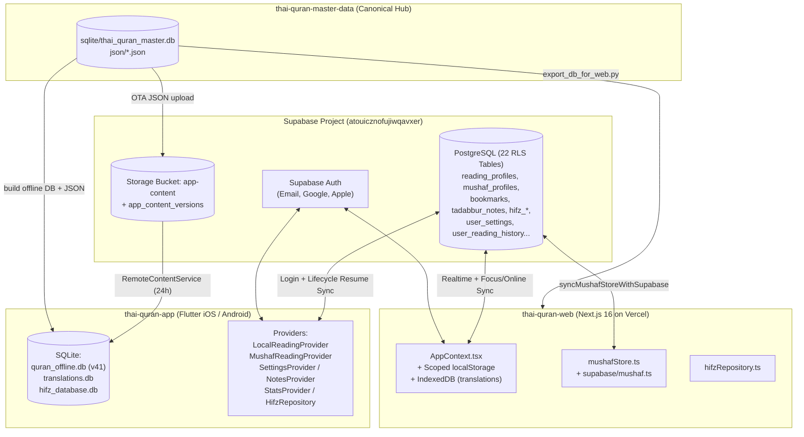

# Launch & Audit Master Plan: `thai-quran-web` & `thai-quran-app`

> [!IMPORTANT]
> **Purpose of This Document**: This is an execution-ready engineering specification and launch audit for **any AI agent or developer** working on `thai-quran-web` (Next.js 16 / Vercel) and `thai-quran-app` (Flutter / iOS & Android). Every finding includes exact file paths, line numbers, root causes, concrete code/SQL fixes, and verification steps.
>
> **Companion Living Architecture Document**: Whenever you complete any upgrade, schema change, or data pipeline change from this plan, you **MUST** update [`LIVE_ARCHITECTURE_AND_UPGRADE_GUIDE.md`](file:///Users/admin/Documents/gits/thai-quran-web/docs/LIVE_ARCHITECTURE_AND_UPGRADE_GUIDE.md).

---

## Live Execution Progress Tracker (Seamless Agent Handover Log)

> [!NOTE]
> **Handover Protocol**: If an AI agent session hits a quota or context limit, the next agent MUST read this section first to see what is `[x] COMPLETED`, what is `[~] IN PROGRESS`, and what is `[ ] PENDING`. Always update this checklist immediately after completing each task.
>
> **User Decisions Confirmed (2026-11-14)**:
> 1. **Account Deletion (`SYNC-01`)**: Delete **everything** belonging to the user (all user tables, including public/anonymous Tadabbur notes, plus the `auth.users` record).
> 2. **Signing & Credentials (`IOS-02`, `AND-01`, `AND-03`)**: Apple `DEVELOPMENT_TEAM = Q79G7KWMQG` (from `prayertimeproject`), Android `upload-keystore.jks` + `key.properties` (from `/Users/admin/Downloads/` / `prayertimeproject`), Android `applicationId = "com.thaiquran.app"`.

- [x] **Phase 1: Supabase SQL Migrations (`SYNC-01`, `SYNC-06`, `POL-01`) — COMPLETED & APPLIED TO PRODUCTION SUPABASE**
  - [x] `supabase/migrations/20261115000000_delete_user_account_rpc.sql` (`public.delete_own_account()` deleting all user data + `auth.users`)
  - [x] `supabase/migrations/20261115001000_user_settings_reader_prefs.sql` (adding `show_word_by_word`, `wbw_language`, `show_footnotes`, `show_tajweed_colors`, `reciter_id` to `user_settings`)
  - [x] `supabase/migrations/20261115002000_tadabbur_moderation_and_blocks.sql` (`tadabbur_reports` & `user_blocks` tables + RLS)
  - [x] Update `docs/SHARED_DATABASE_SCHEMA.sql` (Web + App) & `thai-quran-app/hifz_supabase.sql`
- [x] **Phase 2: `thai-quran-web` Sync, Bugs & UGC Moderation (`SYNC-01`, `SYNC-02`, `SYNC-06`, `SYNC-07`, `SYNC-08`, `BUG-WEB-01`, `BUG-WEB-02`, `POL-01`) — COMPLETED (`tsc` & `npm run build` 878/878 pages passed)**
  - [x] `SYNC-01` (Web): `deleteAccount()` in `src/context/AppContext.tsx` + Delete Account UI & confirmation modal in `src/app/profile/page.tsx` (`clearScopedUserStorage` added in `src/lib/shared/userScope.ts`)
  - [x] `SYNC-02` (Web): Fix Mushaf page & verse bookmarks tombstone deletion & upsert calls in `src/lib/supabase/mushaf.ts`
  - [x] `SYNC-06` (Web): Sync reader preferences & dark mode / font sizes in `src/lib/supabase/types.ts`, `src/lib/supabase/userSettings.ts`, & `src/context/AppContext.tsx`
  - [x] `SYNC-07` & `SYNC-08` (Web): Add deletion tombstones for verse bookmarks (`localReadingStore.ts`, `bookmarks.ts`, `AppContext.tsx`) and Hifz history (`hifzRepository.ts`) + Apple OAuth rate-limit check
  - [x] `BUG-WEB-01`: Fix 113-element `QURAN_SURAH_VERSE_COUNTS` in `src/app/mushaf/[profileId]/page.tsx`
  - [x] `BUG-WEB-02`: Fix `/profile` Problem Reports property names in `src/app/profile/page.tsx`
  - [x] `POL-01` (Web): Add Report Post, Block User, and Community Guidelines consent in `src/lib/supabase/tadabbur.ts` & `src/app/tadabbur/community/page.tsx`
  - [x] Verify `thai-quran-web` with `npx tsc --noEmit` and `npm run build`
- [x] **Phase 3: `thai-quran-app` Sync, Bugs, iOS/Android Readiness & Store Policies — COMPLETED (`flutter analyze` 0 errors/warnings & `flutter test` 91/91 passed)**
  - [x] `SYNC-01` (App): Real `deleteAccount()` calling `rpc('delete_own_account')` + local store wipe in `lib/providers/supabase_provider.dart` & `lib/screens/settings_screen.dart`
  - [x] `SYNC-03` & `SYNC-04` (App): Sync `user_completed_surahs` and stop fake `1:1` writes to `user_reading_history` in `lib/providers/local_reading_provider.dart`
  - [x] `SYNC-05` (App): Persist server UUID on `NotesProvider.saveNote` and support offline deletion tombstones in `lib/providers/notes_provider.dart` & `lib/data/tadabbur_repository.dart`
  - [x] `SYNC-06` & `SYNC-07` (App): Sync all reader preferences in `lib/providers/settings_provider.dart`; trigger `HifzRepository.instance.syncWithSupabase()` on login/resume (`lib/main.dart`, `lib/screens/settings_screen.dart`) and parameterize SQLite query in `lib/database/hifz_repository.dart`
  - [x] `BUG-APP-01`, `BUG-APP-02`, `BUG-APP-03`: Fix `GuestLifecycleService`, `MushafAudioProvider` N+1 fallback & notification channel/artwork, remove dead/duplicate files
  - [x] `IOS-01` & `IOS-02`: Create `ios/Runner/PrivacyInfo.xcprivacy`, wire into `project.pbxproj`, set `DEVELOPMENT_TEAM = Q79G7KWMQG`, refine `NSMicrophoneUsageDescription`
  - [x] `AND-01`, `AND-02`, `AND-03`: `bluetooth_le` `android:required="false"`, copy `key.properties` & `upload-keystore.jks`, wire release signing + `proguard-rules.pro` in `android/app/build.gradle.kts`, update `lib/firebase_options.dart` Android `appId`
  - [x] `POL-01`, `POL-02`, `POL-03` (App): Add Report Post, Block User, and EULA prompt in `lib/screens/tadabbur_community_screen.dart`; remove external web payment fallback on iOS/Android in `lib/widgets/support_dialog.dart`; add Privacy Policy links in `lib/screens/settings_screen.dart` & `lib/widgets/auth_bottom_sheet.dart`
  - [x] Verify `thai-quran-app` with `flutter analyze` and `flutter test` (91/91 tests passed)
- [x] **Phase 4: Update `LIVE_ARCHITECTURE_AND_UPGRADE_GUIDE.md` & Sync Docs — COMPLETED**

---

## Executive Summary & Severity Matrix

| ID | Area | Platform | Severity | Summary |
| :--- | :--- | :--- | :--- | :--- |
| **SYNC-01** | Account Deletion & Store Policy | App + Web + DB | **P0 BLOCKER** | App "Delete Account" (`settings_screen.dart:396`) only calls `signOut()`. Web has no Delete Account UI/API at all. Guaranteed Apple Guideline 5.1.1(v) & Google Play Data Deletion rejection. |
| **SYNC-02** | Mushaf Bookmarks Sync | Web | **P0 CRITICAL** | `syncMushafPageBookmarks` & `syncMushafVerseBookmarks` (`src/lib/supabase/mushaf.ts:577-640`) are dead code (never called), and tombstone filter (`lines 325, 349`) is inverted (`!remote.has(key)`), erasing local deletion tombstones without deleting from Supabase. |
| **SYNC-03** | Completed Surahs Sync | App | **P1 HIGH** | Web syncs `public.user_completed_surahs` (`completedSurahs.ts`), but App (`local_reading_provider.dart:611-621`) only writes completed surahs to local `SharedPreferences` and never syncs to Supabase. |
| **SYNC-04** | Reading History Pollution | App + DB | **P1 HIGH** | `LocalReadingProvider._syncReadDatesWithSupabase` (`local_reading_provider.dart:1451-1481`) inserts fake `'surah_id': '1', 'verse_id': '1'` rows into `user_reading_history` for date-only streaks, polluting `StatsProvider` and Web reading history. |
| **SYNC-05** | Tadabbur Note Deletion Bug | App | **P1 HIGH** | `NotesProvider.saveNote` (`notes_provider.dart:150-163`) discards the server UUID returned by Supabase and keeps `id = 'local_...'`. Later `deleteNote` (`line 194`) skips Supabase deletion because `id.startsWith('local_')` is still true, causing deleted notes to resurrect on next sync. |
| **SYNC-06** | Settings Sync Parity | App + Web | **P2 MEDIUM** | Web `AppContext.tsx` (`lines 1318-1365, 2114-2120`) and App `SettingsProvider` (`lines 249-270`) do not sync `showWordByWord`, `wbwLanguage`, `showFootnotes`, `showTajweedColors`, `reciterId`, and Web ignores incoming `is_dark_mode` / font sizes on `applyRemoteSettings`. |
| **SYNC-07** | Hifz Sync Lifecycle & Tombstones | App + Web | **P2 MEDIUM** | App does not trigger `HifzRepository.instance.syncWithSupabase()` on login or app resume (`main.dart:144-169`). Web `hifzRepository.ts` (`lines 466-496`) re-uploads Hifz history deleted on another device. |
| **SYNC-08** | Verse Bookmarks Offline Delete | Web | **P2 MEDIUM** | Web `AppContext.tsx` (`lines 1694-1748`) replaces local bookmarks with remote bookmarks without tracking deletion tombstones (unlike App's `_deletedBookmarkKeys`). |
| **BUG-WEB-01** | Mushaf Surah Verse Counts | Web | **P1 HIGH** | `QURAN_SURAH_VERSE_COUNTS` in `src/app/mushaf/[profileId]/page.tsx:106-113` has only 113 elements (missing `3` for Surah 108 Al-Kawthar), shifting verse counts for Surahs 108–114 and leaving Surah 114 with 1 verse. |
| **BUG-WEB-02** | Profile Problem Reports UI | Web | **P1 HIGH** | `src/app/profile/page.tsx:592-631` reads `surah_number`, `verse_number`, `report_text`, and `status === 'resolved'`, whereas `LegacyErrorReportShape` (`translationReports.ts:46-76`) returns `surah_id`, `ayah_number`, `user_comment`, and `status === 'reviewed_fixed'`. |
| **BUG-WEB-03** | Client JS Bundle Size (38.2 MB) | Web | **P1 HIGH** | `SurahReader.tsx` and `resolveVerseTranslation.ts` statically bundle 9 full Quran translations + 5 footnote JSONs + 3 tafsir JSONs into client JS (~38.2 MB uncompressed), violating `AGENTS.md` and threatening Vercel Hobby quotas. |
| **BUG-APP-01** | Guest 30-Day Flush Data Loss | App | **P1 HIGH** | `LocalReadingProvider.flushGuestDataIfExpired()` (`local_reading_provider.dart:2777-2800`) wipes `_completedReadSurahs`, `_completedReadSurahCounts`, and `_readDates` if `checkAndExpireIfNeeded(isLoggedIn: false)` runs before auth session restore. |
| **BUG-APP-02** | Sequential Audio Fallback N+1 | App | **P1 HIGH** | `MushafAudioProvider._buildPlaylist` (`mushaf_audio_provider.dart:447`) awaits `fetchAyahRecitationUrl` sequentially inside a loop over every verse when chapter segments are unavailable. |
| **IOS-01** | Missing `PrivacyInfo.xcprivacy` | iOS | **P0 BLOCKER** | `ios/Runner/PrivacyInfo.xcprivacy` does not exist. Apple rejects uploads lacking Required Reason API declarations (`ITMS-91053`). |
| **IOS-02** | Signing & Entitlements | iOS | **P0 BLOCKER** | `DEVELOPMENT_TEAM` and `Runner.entitlements` are not configured in `ios/Runner.xcodeproj/project.pbxproj`. |
| **AND-01** | Debug Signing on Release Build | Android | **P0 BLOCKER** | `android/app/build.gradle.kts:36` signs `release` builds with `signingConfigs.getByName("debug")`. |
| **AND-02** | Mandatory BLE Hardware Flag | Android | **P0 BLOCKER** | `AndroidManifest.xml:19` sets `<uses-feature android:name="android.hardware.bluetooth_le" android:required="true" />`, blocking devices/tablets without BLE. |
| **AND-03** | Empty `oauth_client` in Firebase | Android | **P1 HIGH** | `android/app/google-services.json:15` has `"oauth_client": []`, causing native `GoogleSignIn` on Android to fail with `ApiException: 10`. |
| **POL-01** | Community UGC Moderation | App + Web + DB | **P0 BLOCKER** | `tadabbur_notes` public community feed (`TadabburCommunityScreen` & `/tadabbur/community`) lacks "Report/Flag Post", "Block User", and EULA acceptance—mandatory under Apple Guideline 1.2 & Google Play UGC Policy. |
| **POL-02** | External Donation Link in App | App | **P0 BLOCKER** | `SupportDialog` (`lib/widgets/support_dialog.dart:368-383, 443-457`) links out to `https://quran-th.com/support` (PromptPay) when IAP products fail to load, violating Apple Guideline 3.1.1 / Google Play Payments policy. |
| **POL-03** | Missing In-App Privacy Policy Link | App | **P0 BLOCKER** | `SettingsScreen` and `AuthBottomSheet` have no link to `https://quran-th.com/privacy`. |

---

## Architecture & Sync Overview



---

## Part 1: Supabase, Cross-Device Sync, User & Profile Audit Plan

### Task SYNC-01: Implement Real End-to-End Account Deletion (DB + App + Web)
**Why**:
- In [`thai-quran-app/lib/screens/settings_screen.dart`](file:///Users/admin/Documents/gits/thai-quran-app/lib/screens/settings_screen.dart#L334-L412), `_confirmDeleteAccount` shows a confirmation dialog claiming to permanently delete the user's account and cloud data, but lines 396–411 only call `await supabaseProv.signOut()`.
- In `thai-quran-web`, [`src/app/profile/page.tsx`](file:///Users/admin/Documents/gits/thai-quran-web/src/app/profile/page.tsx) and [`src/app/settings/page.tsx`](file:///Users/admin/Documents/gits/thai-quran-web/src/app/settings/page.tsx) have no account deletion feature at all.
- Apple App Store Review (Guideline 5.1.1(v)) and Google Play User Data Policy require both **in-app account deletion** and a **web account deletion URL** (`https://quran-th.com/profile` or `https://quran-th.com/delete-account`) that permanently deletes the user's account record and associated personal data.

**Step-by-Step Implementation for AI Agent**:
1. **Create Supabase Migration `thai-quran-web/supabase/migrations/20261115000000_delete_user_account_rpc.sql`**:
   - Define a `SECURITY DEFINER` RPC `public.delete_own_account()` with `SET search_path = public, auth` that verifies `auth.uid() IS NOT NULL`, deletes all user rows across any tables without `ON DELETE CASCADE` (or explicitly deletes from `tadabbur_likes`, `tadabbur_notes`, `translation_reports`, `error_reports`, `bookmarks`, `bookmark_categories`, `mushaf_page_bookmarks`, `mushaf_verse_bookmarks`, `mushaf_recent_readings`, `mushaf_profiles`, `recent_readings`, `user_reading_profiles`, `reading_profiles`, `user_reading_state`, `user_reading_history`, `user_completed_surahs`, `custom_quick_links`, `hifz_progress`, `hifz_history`, `user_settings`, `user_roles`), and finally executes `DELETE FROM auth.users WHERE id = auth.uid();`.
   - Grant `EXECUTE ON FUNCTION public.delete_own_account() TO authenticated;` and revoke from `anon`, `public`.
2. **Update `thai-quran-app`**:
   - In [`lib/providers/supabase_provider.dart`](file:///Users/admin/Documents/gits/thai-quran-app/lib/providers/supabase_provider.dart), add `Future<bool> deleteAccount() async` that calls `await _client.rpc('delete_own_account')`, clears user-scoped `SharedPreferences` and Hifz local SQLite rows, and calls `await signOut()`.
   - In [`lib/screens/settings_screen.dart`](file:///Users/admin/Documents/gits/thai-quran-app/lib/screens/settings_screen.dart#L396-L411), replace `await supabaseProv.signOut()` inside `_confirmDeleteAccount` with `await supabaseProv.deleteAccount()`, plus calls to `localReadingProv.resetAllData()`, `mushafProv.resetAllData()`, `notesProv.clearLocalNotes()`, and `statsProv.clearLocalStats()`. Show an error snackbar if the RPC fails instead of falsely reporting success.
3. **Update `thai-quran-web`**:
   - In [`src/context/AppContext.tsx`](file:///Users/admin/Documents/gits/thai-quran-web/src/context/AppContext.tsx), add `deleteAccount: () => Promise<{ error: string | null }>` that invokes `supabase.rpc('delete_own_account')`, clears all user-scoped `localStorage` keys for that `userId`, and signs out.
   - In [`src/app/profile/page.tsx`](file:///Users/admin/Documents/gits/thai-quran-web/src/app/profile/page.tsx), add a "Delete Account / ลบบัญชีผู้ใช้ถาวร" danger section with a confirmation modal requiring the user to confirm permanent deletion.

---

### Task SYNC-02: Fix Mushaf Page & Verse Bookmarks Sync on Web
**Why**:
- In [`thai-quran-web/src/lib/supabase/mushaf.ts`](file:///Users/admin/Documents/gits/thai-quran-web/src/lib/supabase/mushaf.ts#L311-L365), `performSyncMushafStoreWithSupabase` fetches remote `mushaf_page_bookmarks` and `mushaf_verse_bookmarks`, then runs:
  ```ts
  store.deletedPageBookmarkKeys = store.deletedPageBookmarkKeys.filter((key) => !remotePageBookmarksByKey.has(key));
  ```
  Because `!remotePageBookmarksByKey.has(key)` is `false` whenever the deleted bookmark still exists on Supabase, **the tombstone is immediately discarded before any `DELETE` query is sent to Supabase**, and the deleted bookmark is re-added to `store.pageBookmarks` right below it (`lines 327-335`)!
- Furthermore, helper functions `syncMushafPageBookmarks` (`lines 577-607`) and `syncMushafVerseBookmarks` (`lines 609-640`) at the bottom of `src/lib/supabase/mushaf.ts` are **never called anywhere**.
- Also note: `mushaf_verse_bookmarks` in [`thai-quran-app/lib/providers/mushaf_reading_provider.dart:906`](file:///Users/admin/Documents/gits/thai-quran-app/lib/providers/mushaf_reading_provider.dart#L906) uses `onConflict: 'user_id,mushaf_id,verse_key'`, while [`thai-quran-web/src/lib/supabase/mushaf.ts:624`](file:///Users/admin/Documents/gits/thai-quran-web/src/lib/supabase/mushaf.ts#L624) uses `onConflict: 'user_id,mushaf_id,page_number,verse_key'`.

**Step-by-Step Implementation for AI Agent**:
1. In [`thai-quran-web/src/lib/supabase/mushaf.ts`](file:///Users/admin/Documents/gits/thai-quran-web/src/lib/supabase/mushaf.ts#L311-L365):
   - **Step A**: Before pulling/merging remote `mushaf_page_bookmarks` and `mushaf_verse_bookmarks`, process `store.deletedPageBookmarkKeys` and `store.deletedVerseBookmarkKeys` by issuing Supabase `.delete()` calls for each tombstone (matching [`mushaf_reading_provider.dart:836-856, 873-895`](file:///Users/admin/Documents/gits/thai-quran-app/lib/providers/mushaf_reading_provider.dart#L836-L895)), and remove those keys from `remotePageBookmarksByKey` / `remoteVerseBookmarksByKey` and clear the tombstones only after the remote delete succeeds.
   - **Step B**: Call `await syncMushafPageBookmarks(userId, store)` and `await syncMushafVerseBookmarks(userId, store)` during `performSyncMushafStoreWithSupabase` to upsert local bookmarks missing on remote.
   - **Step C**: Align the unique constraint and `onConflict` target for `mushaf_verse_bookmarks` across Web (`src/lib/supabase/mushaf.ts:624`), App (`lib/providers/mushaf_reading_provider.dart:906`), and Supabase schema (`user_id,mushaf_id,page_number,verse_key`).

---

### Task SYNC-03: Implement `user_completed_surahs` Cloud Sync in `thai-quran-app`
**Why**:
- Web syncs completed Surahs (`mode: 'read' | 'review'`, `surah_id`, `completed_at`) with Supabase table `public.user_completed_surahs` in [`thai-quran-web/src/lib/supabase/completedSurahs.ts`](file:///Users/admin/Documents/gits/thai-quran-web/src/lib/supabase/completedSurahs.ts#L1-L70).
- App tracks `_completedReadSurahs` (`Set<int>`) and `_completedReadSurahCounts` (`Map<int, int>`) in [`thai-quran-app/lib/providers/local_reading_provider.dart`](file:///Users/admin/Documents/gits/thai-quran-app/lib/providers/local_reading_provider.dart#L550-L553, L611-L621, L697-L716), but **only persists them to local `SharedPreferences`**.

**Step-by-Step Implementation for AI Agent**:
1. In [`thai-quran-app/lib/providers/local_reading_provider.dart`](file:///Users/admin/Documents/gits/thai-quran-app/lib/providers/local_reading_provider.dart):
   - Add `_deletedCompletedReadSurahs` (`Set<int>`) so untoggling a completed Surah on mobile deletes the row from `public.user_completed_surahs` (`mode = 'read'`).
   - Add `Future<void> _syncCompletedSurahsWithSupabase(String userId)` called inside `syncWithSupabase()`:
     - Delete any surahs in `_deletedCompletedReadSurahs` from `public.user_completed_surahs` where `user_id = userId AND mode = 'read'`.
     - Select `surah_id, completed_at` from `public.user_completed_surahs` where `user_id = userId AND mode = 'read'`.
     - Union-merge remote `surah_id`s into `_completedReadSurahs` (initializing `_completedReadSurahCounts[s] = max(currentCount, 1)`).
     - Upsert local `_completedReadSurahs` not yet in remote to `public.user_completed_surahs` with `onConflict: 'user_id,mode,surah_id'`.
   - Call `_scheduleSupabaseSync()` whenever `toggleCompletedReadSurah()` or `incrementCompletedReadSurahCount()` mutates state.

---

### Task SYNC-04: Stop `LocalReadingProvider` From Polluting `user_reading_history` With Fake `1:1` Rows
**Why**:
- In [`thai-quran-app/lib/providers/local_reading_provider.dart:1451-1481`](file:///Users/admin/Documents/gits/thai-quran-app/lib/providers/local_reading_provider.dart#L1451-L1481), `_syncReadDatesWithSupabase` writes date-only entries to `public.user_reading_history` by hardcoding `'surah_id': '1', 'verse_id': '1'`.
- Meanwhile, [`StatsProvider`](file:///Users/admin/Documents/gits/thai-quran-app/lib/providers/stats_provider.dart#L118-L221) and Web (`src/lib/supabase/readingHistory.ts`) use `public.user_reading_history` for real per-verse reading history (`verse_key` / `surah_id` + `verse_id`).

**Step-by-Step Implementation for AI Agent**:
1. In [`thai-quran-app/lib/providers/local_reading_provider.dart:1451-1481`](file:///Users/admin/Documents/gits/thai-quran-app/lib/providers/local_reading_provider.dart#L1451-L1481):
   - Change `_syncReadDatesWithSupabase` to **read-only pull** of distinct `read_date` values from `user_reading_history` into `_readDates` (so `_readDates` stays populated from cloud history), and **remove the `.upsert(toInsert)` block** that writes fake `'surah_id': '1', 'verse_id': '1'` rows!
   - Ensure whenever a verse is marked read in `LocalReadingProvider` or `MushafReadingProvider`, `StatsProvider.recordVerseRead(verseKey)` is called with the **actual** `surah:verse` key so `StatsProvider` is the single writer to `user_reading_history` on mobile.

---

### Task SYNC-05: Fix `NotesProvider` Server UUID Assignment & Deletion Tombstones on App
**Why**:
- In [`thai-quran-app/lib/providers/notes_provider.dart:150-163`](file:///Users/admin/Documents/gits/thai-quran-app/lib/providers/notes_provider.dart#L150-L163):
  ```dart
  final saved = await _repo.saveNote(note);
  if (saved != null) {
    _personalNotes[key] = note.copyWith(synced: true);
    await _saveToPrefs();
  ```
  It discards `saved.id` (the real Supabase UUID) and keeps `note.id` (`'local_173...'`). When the user later calls `deleteNote(surahId, verseId)` (`lines 174-200`), `if (!existing.id.startsWith('local_'))` (`line 194`) is `false`, so `_repo.deleteNote(existing.id)` is never called!

**Step-by-Step Implementation for AI Agent**:
1. In [`thai-quran-app/lib/providers/notes_provider.dart:153`](file:///Users/admin/Documents/gits/thai-quran-app/lib/providers/notes_provider.dart#L153), update `_personalNotes[key] = saved.copyWith(synced: true);` so the Supabase-assigned UUID is persisted to `personal_notes_v2`.
2. In `deleteNote(int surahId, int verseId)` (`lines 174-200`), if `existing.id.startsWith('local_')` and the user is logged in, still delete by `(user_id, surah_id, verse_id)` on `tadabbur_notes` (or add a `deleteNoteByVerse(int surahId, int verseId)` fallback in [`lib/data/tadabbur_repository.dart`](file:///Users/admin/Documents/gits/thai-quran-app/lib/data/tadabbur_repository.dart#L105-L114)), and maintain a `_deletedNoteVerseKeys` tombstone list in `SharedPreferences` so offline note deletions are flushed on next `syncWithSupabase()`.

---

### Task SYNC-06: Complete Settings Sync Parity Between Web and App
**Why**:
- In [`thai-quran-web/src/context/AppContext.tsx:1318-1365`](file:///Users/admin/Documents/gits/thai-quran-web/src/context/AppContext.tsx#L1318-L1365), `applyRemoteSettings` ignores `is_dark_mode`, `arabic_font_size`, `thai_font_size`, `thai_font_family`, `keep_awake`, and `language_code`.
- Neither Web (`src/lib/supabase/userSettings.ts`) nor App (`lib/providers/settings_provider.dart:249-270`) syncs `show_word_by_word`, `wbw_language`, `show_footnotes`, `show_tajweed_colors`, or `reciter_id`.

**Step-by-Step Implementation for AI Agent**:
1. Create migration `thai-quran-web/supabase/migrations/20261115001000_user_settings_reader_prefs.sql` adding optional columns to `public.user_settings`:
   - `show_word_by_word boolean not null default true`
   - `wbw_language text not null default 'th'`
   - `show_footnotes boolean not null default true`
   - `show_tajweed_colors boolean not null default false`
   - `reciter_id integer not null default 7`
2. Update [`thai-quran-web/src/lib/supabase/userSettings.ts`](file:///Users/admin/Documents/gits/thai-quran-web/src/lib/supabase/userSettings.ts), [`thai-quran-web/src/context/AppContext.tsx`](file:///Users/admin/Documents/gits/thai-quran-web/src/context/AppContext.tsx#L1318-L1365), and [`thai-quran-app/lib/providers/settings_provider.dart`](file:///Users/admin/Documents/gits/thai-quran-app/lib/providers/settings_provider.dart#L249-L335) so all reader preferences sync bidirectionally using `updated_at` Last-Write-Wins.

---

### Task SYNC-07 & SYNC-08: Hifz Lifecycle Sync + Bookmark/Hifz Deletion Tombstones
**Step-by-Step Implementation for AI Agent**:
1. **Trigger Hifz Sync on Login & App Resume in App**:
   - In [`thai-quran-app/lib/main.dart:144-169`](file:///Users/admin/Documents/gits/thai-quran-app/lib/main.dart#L144-L169) (`_syncExternalProvidersWithAuth`) and [`lib/screens/settings_screen.dart:126-142`](file:///Users/admin/Documents/gits/thai-quran-app/lib/screens/settings_screen.dart#L126-L142) (`_handleManualSync`), add `HifzRepository.instance.syncWithSupabase()`.
2. **Parameterize SQLite Query in `HifzRepository`**:
   - In [`thai-quran-app/lib/database/hifz_repository.dart:607-608`](file:///Users/admin/Documents/gits/thai-quran-app/lib/database/hifz_repository.dart#L607-L608), replace raw string interpolation `WHERE id IN ($ids)` with parameterized placeholders (`List.filled(unsynced.length, '?').join(',')` and `whereArgs`).
3. **Track Verse Bookmark Deletion Tombstones on Web**:
   - In [`thai-quran-web/src/lib/shared/localReadingStore.ts`](file:///Users/admin/Documents/gits/thai-quran-web/src/lib/shared/localReadingStore.ts) and [`src/context/AppContext.tsx:1694-1748`](file:///Users/admin/Documents/gits/thai-quran-web/src/context/AppContext.tsx#L1694-L1748), record deleted bookmark keys (`surahId:verseId`) in a scoped `deletedBookmarkKeys` list when offline, and flush those deletions to `public.bookmarks` before pulling remote bookmarks during `syncAllWithSupabaseInternal`.
4. **Update `docs/SHARED_DATABASE_SCHEMA.sql` & `hifz_supabase.sql`**:
   - Synchronize `docs/SHARED_DATABASE_SCHEMA.sql` in both repos with the actual production migrations (`tadabbur_notes` with `is_public`, `is_anonymous`, `likes_count`; `hifz_history.id` as `text primary key`; `mushaf_recent_readings.recent_key`).
   - Remove deprecated `_loadBookmarks()` query to `user_bookmarks` in [`thai-quran-app/lib/providers/supabase_provider.dart:358-405`](file:///Users/admin/Documents/gits/thai-quran-app/lib/providers/supabase_provider.dart#L358-L405).

---

## Part 2: Web & App Bug Fixes Plan

### Task BUG-WEB-01: Fix 113-Element `QURAN_SURAH_VERSE_COUNTS` in Mushaf Reader
- **File**: [`thai-quran-web/src/app/mushaf/[profileId]/page.tsx:106-113`](file:///Users/admin/Documents/gits/thai-quran-web/src/app/mushaf/%5BprofileId%5D/page.tsx#L106-L113)
- **Root Cause**: Line 112 has `5, 4, 7, 6, 3, 5, 4, 5, 6` for Surahs 105–114, omitting `3` for **Surah 108 (Al-Kawthar)**.
- **Fix**: Replace the local `QURAN_SURAH_VERSE_COUNTS` constant in `src/app/mushaf/[profileId]/page.tsx` by importing the canonical 114-element `QURAN_SURAH_VERSE_COUNTS` directly from [`@/lib/shared/quranContract`](file:///Users/admin/Documents/gits/thai-quran-web/src/lib/shared/quranContract.ts#L419-L427).

### Task BUG-WEB-02: Fix `/profile` Problem Reports Rendering
- **File**: [`thai-quran-web/src/app/profile/page.tsx:58-78, 592-631`](file:///Users/admin/Documents/gits/thai-quran-web/src/app/profile/page.tsx#L592-L631)
- **Root Cause**: `ProfilePage` inspects `report.surah_number`, `report.verse_number`, `report.report_text`, `report.issue_type`, and `report.status === 'resolved'`, none of which exist on `LegacyErrorReportShape` returned by [`src/lib/supabase/translationReports.ts:46-76`](file:///Users/admin/Documents/gits/thai-quran-web/src/lib/supabase/translationReports.ts#L46-L76).
- **Fix**: Update `src/app/profile/page.tsx:592-631` to read:
  - `report.surah_id` and `report.ayah_number` for the `/surah/${report.surah_id}?ayah=${report.ayah_number}` link and badge.
  - `report.user_comment` (with fallback to `report.reported_verse_text`) for the body text.
  - `report.status === 'reviewed_fixed'` for the resolved badge (`แก้ไขแล้ว / Resolved`), `report.status === 'reviewed_not_needed'` for reviewed/closed, and `'pending_review'` for pending.
  - Display `report.admin_resolution_notes` when present so users can see scholar/admin responses.

### Task BUG-WEB-03: Decouple Non-Default Translations & Tafsirs From Client JS Bundle
- **Files**:
  - [`thai-quran-web/src/lib/translations/resolveVerseTranslation.ts:4-12`](file:///Users/admin/Documents/gits/thai-quran-web/src/lib/translations/resolveVerseTranslation.ts#L4-L12)
  - [`thai-quran-web/src/components/SurahReader.tsx:7-16`](file:///Users/admin/Documents/gits/thai-quran-web/src/components/SurahReader.tsx#L7-L16)
  - [`thai-quran-web/src/lib/shortTafsir.ts:1-10`](file:///Users/admin/Documents/gits/thai-quran-web/src/lib/shortTafsir.ts#L1-L10)
  - [`thai-quran-web/src/lib/thaiFootnotes.ts:1-10`](file:///Users/admin/Documents/gits/thai-quran-web/src/lib/thaiFootnotes.ts#L1-L10)
- **Root Cause**: Static ES imports bundle 9 full translations, 5 footnote catalogs, and 3 Mokhtasar tafsirs (~38.2 MB uncompressed JS) into the client bundle for `/surah/[id]` and `/mushaf/[profileId]`.
- **Fix**:
  1. Keep only `thai_v3.json` and `thai_footnotes.json` bundled or fetched by default (per `AGENTS.md:55-58`).
  2. Move secondary static JSONs (`en_saheeh.json`, `en_abdelhaleem.json`, `en_hilali_khan.json`, `en_bridges.json`, `en_usmani.json`, `ms_basmeih.json`, `thai_v3_old.json`, `tafsir_thai_mokhtasar.json`, `tafsir_eng_mokhtasar.json`, `indonesian-mokhtasar.json`) to lazy dynamic `import()` or `/public/data/` on-demand `fetch()` with `IndexedDB` / memory caching when the user selects that translation or opens a Tafsir drawer.

### Task BUG-APP-01: Prevent `GuestLifecycleService` From Wiping Logged-Out User Progress
- **Files**: [`thai-quran-app/lib/services/guest_lifecycle_service.dart:41-80`](file:///Users/admin/Documents/gits/thai-quran-app/lib/services/guest_lifecycle_service.dart#L41-L80) and [`thai-quran-app/lib/providers/local_reading_provider.dart:2777-2800`](file:///Users/admin/Documents/gits/thai-quran-app/lib/providers/local_reading_provider.dart#L2777-L2800)
- **Fix**:
  1. Do not run `GuestLifecycleService.checkAndExpireIfNeeded` until `Supabase.instance.client.auth.currentSession` has been evaluated.
  2. Do not clear `_completedReadSurahs`, `_completedReadSurahCounts`, or `_readDates` inside `flushGuestDataIfExpired()`.

### Task BUG-APP-02: Fix Sequential Network Calls & Notification Config in `MushafAudioProvider`
- **Files**: [`thai-quran-app/lib/providers/mushaf_audio_provider.dart:412-489`](file:///Users/admin/Documents/gits/thai-quran-app/lib/providers/mushaf_audio_provider.dart#L412-L489) and [`thai-quran-app/lib/main.dart:67-71`](file:///Users/admin/Documents/gits/thai-quran-app/lib/main.dart#L67-L71)
- **Fix**:
  1. In `MushafAudioProvider._buildPlaylist()`, if chapter segments are unavailable, do **not** call `_foundationRepo.fetchAyahRecitationUrl` sequentially per verse inside a `for` loop; instead, construct the deterministic EveryAyah CDN URL (`https://everyayah.com/data/${reciter.everyAyahFolder}/$chapter$ayah.mp3`) or fetch chapter audio metadata once per unique surah.
  2. Replace the remote GitHub `artUri` (`https://raw.githubusercontent.com/doxman13/thai-quran-app/main/assets/icons/playstore-icon.png`) with a local `file://` URI copied from bundled `assets/icons/playstore-icon.png` into `${supportDir}/notification_icon.png` or `https://quran-th.com/icons/icon-512x512.png`.
  3. In `lib/main.dart:68`, change `androidNotificationChannelId` from `'com.ryanheise.bg_demo.channel.audio'` to `'com.abuzayd.iqra.channel.audio'`.

### Task BUG-APP-03: Clean Up Dead & Duplicate Files in `thai-quran-app`
- Delete unused stub [`lib/screens/settings_provider.dart`](file:///Users/admin/Documents/gits/thai-quran-app/lib/screens/settings_provider.dart).
- Delete dead provider [`lib/providers/bookmark_provider.dart`](file:///Users/admin/Documents/gits/thai-quran-app/lib/providers/bookmark_provider.dart).
- Remove accidental log file `ios/Runner/Log 2026-07-29 14_28_00.txt`.
- Refactor [`lib/screens/settings_screen.dart:2291-2628`](file:///Users/admin/Documents/gits/thai-quran-app/lib/screens/settings_screen.dart#L2291-L2628) (`_AuthBottomSheetContent`) to reuse [`lib/widgets/auth_bottom_sheet.dart`](file:///Users/admin/Documents/gits/thai-quran-app/lib/widgets/auth_bottom_sheet.dart).

---

## Part 3: iOS Ready Checker, Android Ready Checker & Store Policy Plan

### 3.1 iOS Ready Checker (`thai-quran-app/ios/`)

| Check Item | Current State | Status | Action Required |
| :--- | :--- | :--- | :--- |
| **Bundle ID** | `com.abuzayd.iqra` (`project.pbxproj:494`) | PASS | Verify matches App Store Connect record. |
| **Min iOS Deployment Target** | `15.1` (`Podfile:1`, `project.pbxproj:472`) | PASS | Consistent across Podfile and Xcode project. |
| **App Icons & LaunchScreen** | Complete `AppIcon.appiconset` (incl. 1024x1024) + `LaunchScreen.storyboard` | PASS | Ready. |
| **Background Audio Mode** | `UIBackgroundModes: [audio]` in `Info.plist:84-87` | PASS | Ready for lock-screen & background recitation. |
| **OAuth Custom URL Scheme** | `io.supabase.thaiquran` in `Info.plist:73-83` | PASS | Matches `SupabaseProvider` redirect URI. |
| **Permission Usage Strings** | `NSMicrophoneUsageDescription`, `NSBluetoothAlwaysUsageDescription` (`Info.plist:5-8, 88-89`) | WARN | Make `NSMicrophoneUsageDescription` explicitly state: *"Thai Quran uses the microphone for offline AI Quran recitation tracking in Hifz mode and voice verse search."* |
| **Privacy Manifest (`PrivacyInfo.xcprivacy`)** | **MISSING** in `ios/Runner/` | **BLOCKER** | Create `ios/Runner/PrivacyInfo.xcprivacy` and add to `Runner` target resources in `project.pbxproj`. |
| **Xcode Team & Entitlements** | `DEVELOPMENT_TEAM` unset; no `Runner.entitlements` | **BLOCKER** | Set `DEVELOPMENT_TEAM` in Xcode and add `Runner/Runner.entitlements` if enabling native Sign in with Apple / Associated Domains. |
| **Apple Sign-In (Guideline 4.8)** | Offered in UI via Supabase Web OAuth (`supabase_provider.dart:177-206`) | PASS / WARN | Ensure Apple Service ID & return URL `https://atouicznofujiwqavxer.supabase.co/auth/v1/callback` are active in Apple Developer Portal. |
| **Account Deletion (Guideline 5.1.1(v))** | Calls `signOut()` only (`settings_screen.dart:396`) | **BLOCKER** | Implement **Task SYNC-01** (`delete_own_account` RPC). |

#### Concrete Spec for `ios/Runner/PrivacyInfo.xcprivacy` (Task IOS-01):
Create `thai-quran-app/ios/Runner/PrivacyInfo.xcprivacy` declaring:
- `NSPrivacyTracking`: `false`
- `NSPrivacyTrackingDomains`: `[]`
- `NSPrivacyCollectedDataTypes`: Email Address & Name (for optional account sync, linked to user, not used for tracking), Audio Data (ephemeral voice search / offline on-device Hifz recitation).
- `NSPrivacyAccessedAPITypes`:
  - `NSPrivacyAccessedAPICategoryUserDefaults` (`CA92.1` — access user defaults inside the app).
  - `NSPrivacyAccessedAPICategoryFileTimestamp` (`C617.1` — access timestamps of files inside app container).
  - `NSPrivacyAccessedAPICategorySystemBootTime` (`35F9.1` — measure elapsed time inside app).
  - `NSPrivacyAccessedAPICategoryDiskSpace` (`E174.1` — check disk space before writing offline SQLite/ONNX models).

---

### 3.2 Android Ready Checker (`thai-quran-app/android/`)

| Check Item | Current State | Status | Action Required |
| :--- | :--- | :--- | :--- |
| **Application ID** | `com.abuzayd.iqra` (`android/app/build.gradle.kts:23`) | PASS | Matches iOS bundle ID & Play Console. |
| **AGP & Kotlin** | AGP `9.0.1`, Kotlin `2.3.20`, Java `17` | PASS | Modern toolchain with 16KB page size packaging support. |
| **Release Signing (`build.gradle.kts:36`)** | Uses `signingConfigs.getByName("debug")` | **BLOCKER** | Configure `key.properties` lookup + `signingConfigs.create("release")` in `android/app/build.gradle.kts`. |
| **BLE Hardware Requirement (`AndroidManifest.xml:19`)** | `<uses-feature android:name="android.hardware.bluetooth_le" android:required="true" />` | **BLOCKER** | Change `android:required="true"` to `android:required="false"` in `android/app/src/main/AndroidManifest.xml:19`. |
| **Google Sign-In (`google-services.json:15`)** | `"oauth_client": []` (empty array) | **HIGH** | Register debug & release SHA-1 / SHA-256 fingerprints in Firebase Console for `com.abuzayd.iqra` and download updated `android/app/google-services.json`. |
| **ProGuard / R8 Rules** | No `android/app/proguard-rules.pro` | **MEDIUM** | Create `android/app/proguard-rules.pro` keeping `com.ryanheise.**` (`just_audio_background` / `audio_service`), `id.flutter.flutter_background_service.**`, and `ai.onnxruntime.**`. |
| **16KB Page Size Alignment (Android 15+)** | Uses `onnxruntime_v2: ^1.22.0` + `sqflite` | **VERIFY** | Run `flutter build appbundle --release` and verify in Android Studio APK Analyzer that `libonnxruntime.so` has 16KB ELF segment alignment. |
| **Foreground Services Declaration** | Declares `FOREGROUND_SERVICE_MEDIA_PLAYBACK` & `FOREGROUND_SERVICE_DATA_SYNC` | **CONSOLE** | Record short screen-recording demo videos of background Quran audio notification and translation download notification for Play Console submission. |

---

### 3.3 Store Policy Compliance (Apple App Store & Google Play)

#### Task POL-01: Add Community UGC Moderation (Report Post, Block User, EULA Prompt)
- **Why**: Both [`thai-quran-app/lib/screens/tadabbur_community_screen.dart`](file:///Users/admin/Documents/gits/thai-quran-app/lib/screens/tadabbur_community_screen.dart#L144-L221) and [`thai-quran-web/src/app/tadabbur/community/page.tsx`](file:///Users/admin/Documents/gits/thai-quran-web/src/app/tadabbur/community/page.tsx) allow users to publish public reflections to `public.tadabbur_notes` (`is_public = true`). Under **Apple App Store Guideline 1.2** and **Google Play UGC Policy**, any app with user-generated public posts **MUST** include:
  1. First-time Community Guidelines / Terms agreement before publishing a public reflection.
  2. A **"Report / Flag Inappropriate Content"** action on every community card.
  3. A **"Block User"** action on every community card that immediately hides all posts from that `user_id`.
- **Implementation**:
  1. Create migration `thai-quran-web/supabase/migrations/20261115002000_tadabbur_moderation_and_blocks.sql` adding `public.tadabbur_reports` (`id`, `note_id`, `reporter_user_id`, `reason`, `details`, `created_at`) and `public.user_blocks` (`blocker_user_id`, `blocked_user_id`, `created_at`, PK `(blocker_user_id, blocked_user_id)`).
  2. In `thai-quran-app` (`lib/screens/tadabbur_community_screen.dart` & `lib/data/tadabbur_repository.dart`) and `thai-quran-web` (`src/app/tadabbur/community/page.tsx` & `src/lib/supabase/tadabbur.ts`):
     - Filter out notes whose `user_id` is in the current user's blocked list (plus local `SharedPreferences` / `localStorage` blocked list for guests).
     - Add a `PopupMenuButton` (`...`) on each `_CommunityNoteCard` with **"รายงานโพสต์ที่ไม่เหมาะสม (Report Post)"** and **"ซ่อนโพสต์จากผู้ใช้นี้ (Block User)"**.
     - Require a checkbox/confirmation of Community Respect Guidelines before toggling a reflection to `isPublic = true`.
     - Remove guest posting UI in `tadabbur_community_screen.dart:154` (require sign-in before posting public UGC).

#### Task POL-02: Remove External Donation Link Fallback on iOS & Android (`SupportDialog`)
- **Why**: In [`thai-quran-app/lib/widgets/support_dialog.dart:368-383, 443-457`](file:///Users/admin/Documents/gits/thai-quran-app/lib/widgets/support_dialog.dart#L368-L383), when `InAppPurchaseService` returns no products (e.g. before IAP products are approved or if StoreKit is unreachable), it displays a button linking to `https://quran-th.com/support` (PromptPay/bank transfer). Apple App Review (Guideline 3.1.1) and Google Play Payments policy reject apps that direct users to external web payment/donation pages from an in-app tipping modal.
- **Implementation**:
  - In `lib/widgets/support_dialog.dart`, guard `_openWebSupport` so on `!kIsWeb && (Platform.isIOS || Platform.isAndroid)` it never links to an external donation URL; instead display a polite message (`"ระบบสนับสนุนผ่าน App Store / Google Play กำลังอยู่ระหว่างการเชื่อมต่อ กรุณาลองใหม่อีกครั้งในภายหลัง"`) with a retry button for `iapService.loadProducts()`.

#### Task POL-03: Add Privacy Policy & Terms Links Inside `thai-quran-app`
- **Why**: Neither [`lib/screens/settings_screen.dart`](file:///Users/admin/Documents/gits/thai-quran-app/lib/screens/settings_screen.dart) nor [`lib/widgets/auth_bottom_sheet.dart`](file:///Users/admin/Documents/gits/thai-quran-app/lib/widgets/auth_bottom_sheet.dart) links to the Privacy Policy (`https://quran-th.com/privacy`).
- **Implementation**:
  - Add a **"นโยบายความเป็นส่วนตัว (Privacy Policy)"** row in `SettingsScreen` (About / Account section) and footer text in `AuthBottomSheet` that opens `https://quran-th.com/privacy` via `url_launcher`.

---

## Part 4: Production Infrastructure & Dashboard Verification Checklist

1. **Supabase Dashboard (`atouicznofujiwqavxer`)**:
   - Navigate to **Authentication -> URL Configuration**:
     - Set **Site URL** to `https://quran-th.com`.
     - Ensure **Redirect URLs** contains:
       - `https://quran-th.com/**`
       - `io.supabase.thaiquran://login-callback`
   - Navigate to **SQL Editor** and verify the following migrations are applied in production:
     - `20261110000000_deleted_goals.sql` (`deleted_at` column + `preserve_deleted_goal_tombstone` trigger on `reading_profiles` and `mushaf_profiles`)
     - `20261113000000_mushaf_recent_readings_key.sql` (`recent_key` + `surah_id` on `mushaf_recent_readings`)
     - `20261113010000_fix_future_recent_timestamps.sql` (`clamp_future_sync_timestamps` trigger)
     - New migrations from this plan: `20261115000000_delete_user_account_rpc.sql`, `20261115001000_user_settings_reader_prefs.sql`, `20261115002000_tadabbur_moderation_and_blocks.sql`.
2. **Execution Order for Any AI Agent**:
   1. Apply Phase 1 (Database Migrations & `SYNC-01`..`SYNC-08`).
   2. Apply Phase 2 (Web Bug Fixes `BUG-WEB-01`..`BUG-WEB-03` & `POL-01`) -> verify with `npm run build` in `thai-quran-web`.
   3. Apply Phase 3 (App Bug Fixes `BUG-APP-01`..`BUG-APP-03` & Store Readiness `IOS-01`, `AND-01`..`AND-03`, `POL-01`..`POL-03`) -> verify with `flutter analyze` and `flutter test` in `thai-quran-app`.
   4. Update [`LIVE_ARCHITECTURE_AND_UPGRADE_GUIDE.md`](file:///Users/admin/Documents/gits/thai-quran-web/docs/LIVE_ARCHITECTURE_AND_UPGRADE_GUIDE.md) to reflect all completed items.
