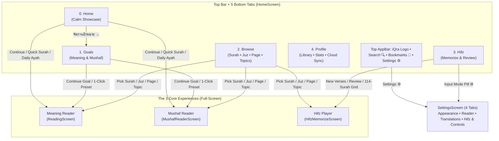

# October 2026 Improvement Plan (`thai-quran-app` ↔ `thai-quran-web` Alignment)

**Branch**: `feat/ux-redesign-aligned`  
**Status**: ✅ Core UX Redesign & Web Alignment Implemented (`flutter analyze` passing with 0 issues)  
**Last Updated**: 2026-10-30

---

## 1. Complete Ecosystem Inventory & Identified Problems

| Category | What Exists in the Codebase | Previous Problem | Status |
| :--- | :--- | :--- | :---: |
| **1. The 3 Core Modes** | • **Meaning Mode** ([`ReadingScreen`](file:///H:/gits/thai-quran-app/lib/screens/reading_screen.dart)): Verse-by-verse Thai translation, Word-by-Word (WBW), Footnotes, Short Tafsir (*Al-Mukhtasar*), Audio player, Auto-scroll. • **Mushaf Mode** ([`MushafReaderScreen`](file:///H:/gits/thai-quran-app/lib/screens/mushaf_reader_screen.dart)): 604-page Madinah Mushaf, Tajweed color-coded Mushaf, Pinch-to-zoom, Page audio. • **Hifz Mode** ([`HifzMemorizeScreen`](file:///H:/gits/thai-quran-app/lib/screens/hifz_memorize_screen.dart)): Takrar `10x Visible + 5x Hidden`, Cumulative linking, `2x/2x` Muraja'ah review, Waqf chunking, Mutashabihat alerts. | Jumping into the 3 modes from Home/Goals/Browse was cluttered with duplicate mode capsules and stock-photo carousels. | ✅ Fixed |
| **2. Goals (Meaning & Mushaf)** | • **Meaning Goals** (`LocalReadingProfile`): By Juz, Surah, Ayah count, or Custom range. • **Mushaf Goals** (`MushafProfile`): By Page range (1–604), Juz, or Surah. • **Archived Goals**: Archive & Restore. | Creation dialogs were embedded inside [`HomeScreen`](file:///H:/gits/thai-quran-app/lib/screens/home_screen.dart), while Archived Goals were hidden inside [`ProfileScreen`](file:///H:/gits/thai-quran-app/lib/screens/profile_screen.dart) bottom sheets. | ✅ Fixed (Moved to [`GoalsScreen`](file:///H:/gits/thai-quran-app/lib/screens/goals_screen.dart)) |
| **3. Bookmarks, Recent Reads & Quick Links** | • **Bookmarks**: Unified Meaning verses + Mushaf pages + Mushaf verses ([`BookmarksScreen`](file:///H:/gits/thai-quran-app/lib/screens/bookmarks_screen.dart)). • **Recent Reads**: Unified history of Meaning & Mushaf sessions. • **Quick Links / Favourite Surahs**: Pinned Surahs (Al-Kahf 18, Yasin 36, Al-Mulk 67, Juz 30) + custom pinned Surahs. | Quick Links on Home had unlocalized English strings (`"Read every night"`, `"Add Quick Link"`), and `BookmarksScreen` could not be deep-linked to a specific tab. | ✅ Fixed |
| **4. Tadabbur (Personal Notes & Community Feed)** | • **Private Notes** ([`TadabburPrivateScreen`](file:///H:/gits/thai-quran-app/lib/screens/tadabbur_private_screen.dart)) • **Community Feed** ([`TadabburCommunityScreen`](file:///H:/gits/thai-quran-app/lib/screens/tadabbur_community_screen.dart)): Public reflections, Likes. • **Home Preview**: Community reflections preview card. | Community Tadabbur had no discovery entry point on Home. | ✅ Fixed |
| **5. Browse, Search & Discovery** | • **Surah (114)**, **Juz (30)**, **Mushaf Page (604)**, **Topics (`หัวข้อ`)** ([`BrowseScreen`](file:///H:/gits/thai-quran-app/lib/screens/browse_screen.dart)) | `HomeScreen` contained ~220 lines of dead search sliver code duplicating `BrowseScreen`. | ✅ Fixed |
| **6. Hifz Hub & Sub-Screens** | • [`HifzLandingScreen`](file:///H:/gits/thai-quran-app/lib/screens/hifz_landing_screen.dart) (Dashboard) • [`HifzWizardSetupScreen`](file:///H:/gits/thai-quran-app/lib/screens/hifz_wizard_setup_screen.dart) • [`HifzHistoryScreen`](file:///H:/gits/thai-quran-app/lib/screens/hifz_history_screen.dart) • [`HifzGuideScreen`](file:///H:/gits/thai-quran-app/lib/screens/hifz_guide_screen.dart) | `HifzLandingScreen` had 5 redundant stacked banners/cards that all launched the same wizard, and hid the 114-Surah Mastery list on a separate screen. | ✅ Fixed |
| **7. Unified Settings** | • [`SettingsScreen`](file:///H:/gits/thai-quran-app/lib/screens/settings_screen.dart) • [`HifzSettingsScreen`](file:///H:/gits/thai-quran-app/lib/screens/hifz_settings_screen.dart) | `HifzSettingsScreen` (1,639 lines) duplicated Dark Mode, Language, Keep Screen Awake, Font Sizes, and Translations from `SettingsScreen`. | ✅ Fixed (Unified 4-Tab Settings) |
| **8. Profile, Library & Stats** | • [`ProfileScreen`](file:///H:/gits/thai-quran-app/lib/screens/profile_screen.dart) • [`StatsProvider`](file:///H:/gits/thai-quran-app/lib/providers/stats_provider.dart) | Reading stats and library links were hidden when logged out (guest mode), and duplicated goal-management sheets. | ✅ Fixed |

---

## 2. Implementation Checklist (What Has Been Done)

### Phase 1: Git Branch & Provider Enhancements
- [x] Created and switched to branch `feat/ux-redesign-aligned` in `H:\gits\thai-quran-app`.
- [x] Added `restoreProfile(String profileId)` and `archivedCustomProfiles` getter to [`MushafReadingProvider`](file:///H:/gits/thai-quran-app/lib/providers/mushaf_reading_provider.dart) so archived Mushaf goals can be restored just like Meaning goals.

### Phase 2: Screen 1 — Clean Home Showcase ([`lib/screens/home_screen.dart`](file:///H:/gits/thai-quran-app/lib/screens/home_screen.dart))
- [x] **5-Tab Bottom Navigation Bar**:
  - `Tab 0`: **หน้าแรก (Home)** — Calm showcase dashboard
  - `Tab 1`: **เป้าหมาย (Goals)** — Dedicated [`GoalsScreen`](file:///H:/gits/thai-quran-app/lib/screens/goals_screen.dart)
  - `Tab 2`: **สำรวจ (Browse)** — [`BrowseScreen`](file:///H:/gits/thai-quran-app/lib/screens/browse_screen.dart) (Surah / Juz / Page / Topics)
  - `Tab 3`: **ท่องจำ (Hifz)** — [`HifzLandingScreen`](file:///H:/gits/thai-quran-app/lib/screens/hifz_landing_screen.dart)
  - `Tab 4`: **โปรไฟล์ (Profile)** — [`ProfileScreen`](file:///H:/gits/thai-quran-app/lib/screens/profile_screen.dart)
- [x] **Top AppBar**: Brand `iQra` badge + Search icon (jumps to Browse/Search) + Bookmarks/Recent icon + Settings icon.
- [x] **Removed Home Clutter**: Removed all goal creation/edit dialogs, stock photo carousels, and dead search sliver code (~2,500 lines of clutter removed).
- [x] **6 Clean Showcase Sections on Home**:
  - [x] **1. Greeting & 7-Day Reading Streak Strip**: Clean emerald check circles + active streak pill.
  - [x] **2. Unified "Continue Reading" Hero Card**: Deep emerald (`#062C2B` → `#0E5A4A`) card with subtle gold `ٱقْرَأْ` calligraphy watermark, mode badge (Meaning or Mushaf), last-read details, `ประวัติอ่านล่าสุด →` link, and a 100% opaque gold CTA button (`อ่านต่อจากจุดเดิม`).
  - [x] **3. Active Goals Snapshot (Read-Only Display)**: Compact progress rows for active Meaning (`#0E5B59`) and Mushaf (`#8A6530`) goals with a `จัดการเป้าหมาย →` button that switches to the Goals tab.
  - [x] **4. Quick Surah Access Row**: Localized quick pills for *Al-Kahf (18)*, *Yasin (36)*, *Al-Mulk (67)*, *Juz 30 (78)*, plus custom pinned Surahs (`เพิ่มทางลัด`).
  - [x] **5. Daily Featured Verse & Short Tafsir (*Al-Mukhtasar*)**: Curated inspiring verses with Uthmanic Arabic, Thai/English translation, expandable *Al-Mukhtasar* short tafsir box, `[🔀]` shuffle button, and `อ่านในบริบทซูเราะฮฺ`.
  - [x] **6. Community Tadabbur Reflections Preview**: Displays recent public reflections from `TadabburRepository` with a `ดูทั้งหมด →` button opening [`TadabburCommunityScreen`](file:///H:/gits/thai-quran-app/lib/screens/tadabbur_community_screen.dart).

### Phase 3: Screen 2 — Dedicated Goals Page ([`lib/screens/goals_screen.dart`](file:///H:/gits/thai-quran-app/lib/screens/goals_screen.dart))
- [x] Created [`GoalsScreen`](file:///H:/gits/thai-quran-app/lib/screens/goals_screen.dart) aligned with `thai-quran-web`'s `ModernGoalsView.tsx`.
- [x] **8 Recommended 1-Click Presets**:
  1. `ramadan_khatam_meaning` (ค็อตม์เดือนรอมฎอน 30 ญุซอ์)
  2. `ramadan_khatam_mushaf` (ค็อตม์มุศหัฟ 604 หน้า)
  3. `full_khatam_meaning` (อ่านจบอัลกุรอานพร้อมความหมาย)
  4. `deep_study_baqarah` (ศึกษาซูเราะฮฺอัล-บะเกาะเราะฮฺ)
  5. `juz_amma_meaning` (ญุซอ์อัมมะ — ญุซอ์ที่ 30)
  6. `daily_habit_mulk` (อ่านซูเราะฮฺอัล-มุลก์ทุกคืน)
  7. `mushaf_habit_2pages` (อ่านมุศหัฟวันละ 2 หน้า — ญุซอ์ที่ 1)
  8. `mushaf_juz_amma` (อ่านมุศหัฟญุซอ์ที่ 30 — หน้า 582–604)
- [x] **Filter Tabs**: `ทั้งหมด (All)` / `ความหมาย (Meaning)` / `มุศหัฟ 604 หน้า (Mushaf)`.
- [x] **Goal Progress Cards**: Distinct Emerald (`#0E5B59`) for Meaning and Amber-Gold (`#8A6530`) for Mushaf, showing progress bar, *"อ่านค้างไว้ที่ล่าสุด (Currently Reading At)"* box, `แก้ไข (Edit)`, `จัดเก็บ (Archive)`, and `อ่านต่อ (Continue)` CTA.
- [x] **Archived Goals Drawer**: Collapsible section at the bottom to restore archived Meaning and Mushaf goals in 1 tap.
- [x] **Unified 4-Step Goal Creator Modal**: Mode selector (Meaning vs Mushaf) → 1-Click Presets → Goal Name → Range selector (by Juz, Surah, Ayah count, Custom range, or Mushaf Page range).

### Phase 4: Screen 3 — Streamlined Hifz Dashboard ([`lib/screens/hifz_landing_screen.dart`](file:///H:/gits/thai-quran-app/lib/screens/hifz_landing_screen.dart))
- [x] Replaced the redundant 5-banner stack with the clean 4-part layout matching `thai-quran-web`'s `HifzLanding.tsx`:
  - [x] **1. Active Session Resume Banner**: Amber card shown when an active session exists, with `ท่องต่อ (Resume)` and `ยกเลิก (Discard)`.
  - [x] **2. Deep Emerald Takrar Hero Card**: Direct `[ ▶ เริ่มท่องอายะฮฺใหม่ (New Verses) ]` and `[ 🔄 ทบทวนความจำ (Review Mode) ]` buttons + header actions for Guide, History, and Hifz Controls.
  - [x] **3. Three Interactive Stat & Control Pills**:
    - `จำขึ้นใจแล้ว (Mastered / 114)` — filters the grid below
    - `กำลังท่องจำ (In Progress / 114)` — filters the grid below
    - `วิธีเลื่อนอายะฮฺ (Input Mode ⚙)` — opens Settings directly on the `Hifz & Controls` tab
  - [x] **4. Embedded 114-Surah Mastery List**: Search bar + filter chips (`ทั้งหมด 114`, `กำลังท่อง`, `จำขึ้นใจแล้ว`, `ญุซอ์ 29 & 30`) + tappable Surah cards that open a clean action sheet (`Memorize New Verses` or `Review This Surah`).

### Phase 5: Screen 4 — Unified Categorized Settings ([`lib/screens/settings_screen.dart`](file:///H:/gits/thai-quran-app/lib/screens/settings_screen.dart) & [`lib/screens/hifz_settings_screen.dart`](file:///H:/gits/thai-quran-app/lib/screens/hifz_settings_screen.dart))
- [x] Rebuilt [`SettingsScreen`](file:///H:/gits/thai-quran-app/lib/screens/settings_screen.dart) into 4 categorized tabs matching `thai-quran-web`'s `src/app/settings/page.tsx`:
  - [x] **Tab 1 — `การแสดงผล (Appearance)`**: Dark Mode, Keep Screen Awake, and App Language (`ภาษาไทย` / `English`).
  - [x] **Tab 2 — `การอ่าน & ตัวอักษร (Quran Reader)`**: Live Bismillah Preview Card, Arabic & Translation Font Size sliders, Word-by-Word toggle + language, Footnotes toggle, and Tajweed Color Guide sheet.
  - [x] **Tab 3 — `บทแปล & ออฟไลน์ (Translations)`**: `TranslationManagerSection` + Remote Content update checker.
  - [x] **Tab 4 — `ฮิฟซ์ & รีโมท (Hifz & Controls)`**: Hifz Input Mode (`In-App Tally`, `Bluetooth Shutter`, `BLE Smart Ring` + `BleDeviceManagementUI`), Offline AI Voice Recitation Tracking + Adaptive Noise Filter, and Reciter Playback Volume slider.
- [x] Simplified [`HifzSettingsScreen`](file:///H:/gits/thai-quran-app/lib/screens/hifz_settings_screen.dart) to delegate directly to `SettingsScreen(initialCategory: SettingsCategoryTab.hifz)`, removing ~1,280 lines of duplicated settings UI while keeping `BleDeviceManagementUI` intact.

### Phase 6: Screen 5 — Profile & Saved Library ([`lib/screens/profile_screen.dart`](file:///H:/gits/thai-quran-app/lib/screens/profile_screen.dart) & [`lib/screens/bookmarks_screen.dart`](file:///H:/gits/thai-quran-app/lib/screens/bookmarks_screen.dart))
- [x] Added `initialTab` support (`0: Recent`, `1: Bookmarks`, `2: Favourites & Notes`) to [`BookmarksScreen`](file:///H:/gits/thai-quran-app/lib/screens/bookmarks_screen.dart).
- [x] Added the **My Saved Library (`คลังส่วนตัวของฉัน`)** quick-launch bar and **6 Interactive Stat Pills** (`Reading Streak`, `Read Today`, `This Week`, `Bookmarks`, `Favourites & Notes`, `Active Goals / Problem Reports`) to the top of [`ProfileScreen`](file:///H:/gits/thai-quran-app/lib/screens/profile_screen.dart) for both guest and signed-in users.
- [x] Removed duplicate reading-goal bottom sheets from `ProfileScreen` (now routes cleanly to the dedicated Goals tab).

### Phase 7: Cross-Language Fuzzy Surah Search & Voice Search Stability
- [x] **Cross-Language & Phonetic Surah Text Search** ([`matchesSurahQuery`](file:///H:/gits/thai-quran-app/lib/data/offline_surah_names.dart#L437-L489)):
  - Searches across **Thai** (`offlineSurahNamesTh`), **English** (`offlineSurahNamesEn`), **Arabic** (`offlineSurahNamesAr`), and **Surah number** simultaneously regardless of whether the app UI language is set to Thai or English.
  - Supports normalized phonetic/transliterated matching (strips `Al-`/`An-`/`Ar-`/`Ash-`/`At-` prefixes, hyphens, apostrophes, spaces, silent trailing `-h`, and collapses repeated consonants/vowels so searching `"Jin"`, `"Jinn"`, `"Yaseen"`, `"Kahf"`, `"Mulk"`, `"Fatiha"`, or `"Baqara"` works even when the app is in Thai).
  - Applied across [`BrowseScreen`](file:///H:/gits/thai-quran-app/lib/screens/browse_screen.dart) (Surah & Juz search), [`HifzLandingScreen`](file:///H:/gits/thai-quran-app/lib/screens/hifz_landing_screen.dart), [`SurahPickerSheet`](file:///H:/gits/thai-quran-app/lib/widgets/surah_picker_sheet.dart), [`HifzMushafRangePickerScreen`](file:///H:/gits/thai-quran-app/lib/screens/hifz_mushaf_range_picker_screen.dart), and [`MushafReaderScreen`](file:///H:/gits/thai-quran-app/lib/screens/mushaf_reader_screen.dart).
- [x] **Voice / Mic Search Stability & Auto-Lock** ([`RecitationEngine`](file:///H:/gits/thai-quran-app/lib/services/recitation_engine.dart) & [`VoiceSearchSheet`](file:///H:/gits/thai-quran-app/lib/widgets/voice_search_sheet.dart)):
  - Added dedicated voice-search trailing silence window (`_searchSilenceFramesNeeded = 8`, ~500ms) so natural mid-recitation pauses don't prematurely split phrases.
  - Ignored short 1-token / `<3`-char ambient noise bursts during search inference.
  - Automatically stops the microphone (`stopListening()`) and locks the recognized Arabic text & verse results as soon as valid matches are returned, preventing background noise from resetting or overwriting results until the user explicitly taps the mic button again.

### Phase 8: Web Alignment, Voice Search Auto-Stop & Last-Word Matching Rule
- [x] **Web Search Normalization & Fuzzy Search** ([`src/data/surahNames.ts`](file:///H:/gits/thai-quran-web/src/data/surahNames.ts)):
  - Added `normalizeSurahLatin`, `normalizeSurahThai`, and `matchesSurahSearch` in `thai-quran-web`.
  - Searches Surahs across Thai, English transliteration (ignoring `Al-`, `An-`, repeated letters, punctuation), Arabic, and Surah ID simultaneously.
  - Aligned search across `BrowsePage.tsx`, `GlobalSearchModal.tsx`, `SurahReader.tsx`, `HifzMasteryGrid.tsx`, and `GuestLandingPage.tsx`.
- [x] **Web Voice Search Auto-Stop & Noise Gating** ([`src/components/VoiceSearchModal.tsx`](file:///H:/gits/thai-quran-web/src/components/VoiceSearchModal.tsx)):
  - Added speech energy tracking (`lastSpeechAtRef`), noise suppression after match, and automatic microphone auto-stop (`scheduleSettleAutoStop`) ~1.4s after recitation finishes.
- [x] **Last-Word Recitation Matching Gate in Hifz Mode** (Both Web & App):
  - **Web**: Enforced in [`src/lib/tilawaRecognition.worker.ts`](file:///H:/gits/thai-quran-web/src/lib/tilawaRecognition.worker.ts) (`hasRecitedLastWordOfAyah`), [`src/lib/tilawaRecitation.ts`](file:///H:/gits/thai-quran-web/src/lib/tilawaRecitation.ts), [`src/lib/hifz/useHifzVoiceRecitation.ts`](file:///H:/gits/thai-quran-web/src/lib/hifz/useHifzVoiceRecitation.ts), and [`src/components/hifz/HifzPlayer.tsx`](file:///H:/gits/thai-quran-web/src/components/hifz/HifzPlayer.tsx). Even if the similarity score exceeds the threshold, the Ayah does not complete unless the user recites the final word or its root token.
  - **App**: Tightened `_tokenSliceReachesTargetEnd` and `evaluateAyahMatch` in [`lib/services/ctc_matcher.dart`](file:///H:/gits/thai-quran-app/lib/services/ctc_matcher.dart).

### Phase 9: Surah Selection & Range Picker Clarity (`thai-quran-web` Done, `thai-quran-app` Pending)
- [x] **Web Searchable Surah Picker Component** ([`src/components/shared/SearchableSurahSelect.tsx`](file:///H:/gits/thai-quran-web/src/components/shared/SearchableSurahSelect.tsx)):
  - Replaced raw 114-item `<select>` with rich searchable dropdown.
  - Auto-scrolls the currently selected Surah into the center of the list on open.
  - Includes quick category filters (`ทั้งหมด`, `ญุซอ์ 30`, `ยอดนิยม`, `มักกียะฮฺ`, `มะดะนียะฮฺ`) and `←` / `→` stepper buttons.
  - Integrated into [`HifzWizardModal.tsx`](file:///H:/gits/thai-quran-web/src/components/hifz/HifzWizardModal.tsx), [`HifzMushafRangePickerModal.tsx`](file:///H:/gits/thai-quran-web/src/components/hifz/HifzMushafRangePickerModal.tsx), and [`ModernGoalsView.tsx`](file:///H:/gits/thai-quran-web/src/components/goals/ModernGoalsView.tsx).
- [x] **Web Visual Mushaf Range Picker ("Select from Page") 2-Step Clarity** ([`src/components/hifz/HifzMushafRangePickerModal.tsx`](file:///H:/gits/thai-quran-web/src/components/hifz/HifzMushafRangePickerModal.tsx)):
  - Added interactive 2-Step Mode Pill Bar (`[1. จุดเริ่มต้น (Start)]` and `[2. จุดสิ้นสุด (End)]`).
  - First tap on the page directly sets the new **Start** verse without requiring users to click Reset first!
  - Visually distinguishes the Start Ayah (emerald badge/border) from the End Ayah (amber badge/border).
- [x] **Web Drawer & Browse Auto-Scroll**:
  - Drawer auto-scrolls to the current Surah on opening in both `'verse'` and `'surah'` tabs in [`SurahReader.tsx`](file:///H:/gits/thai-quran-web/src/components/SurahReader.tsx) and [`src/app/mushaf/[profileId]/page.tsx`](file:///H:/gits/thai-quran-web/src/app/mushaf/[profileId]/page.tsx).
  - [`BrowsePage.tsx`](file:///H:/gits/thai-quran-web/src/components/redesign/BrowsePage.tsx) persists and auto-restores scroll position and adds Juz 30 / Popular chips.
- [ ] **Pending for `thai-quran-app` (To Resume)**:
  - [ ] Add `ScrollController` in [`SurahPickerSheet`](file:///H:/gits/thai-quran-app/lib/widgets/surah_picker_sheet.dart) to automatically scroll to `widget.selectedSurah` upon opening.
  - [ ] Update [`HifzMushafRangePickerScreen`](file:///H:/gits/thai-quran-app/lib/screens/hifz_mushaf_range_picker_screen.dart) with 2-step `_selectionStep` (0 = Start, 1 = End) so the first tap sets Start directly without requiring "Reset", and use `SurahPickerSheet` instead of the local raw list.
  - [ ] Add adjacent Surah stepper buttons (`←` / `→`) on Surah cards in [`HifzWizardSetupScreen`](file:///H:/gits/thai-quran-app/lib/screens/hifz_wizard_setup_screen.dart), [`HifzNewVersesSetupScreen`](file:///H:/gits/thai-quran-app/lib/screens/hifz_new_verses_setup_screen.dart), and [`HifzReviewSetupScreen`](file:///H:/gits/thai-quran-app/lib/screens/hifz_review_setup_screen.dart).

---

## 3. Architecture & Visual Blueprint Reference

---

## 4. Optional Next Steps / Future Polish
- [ ] **Visual QA on Device / Emulator**: Test light and dark mode transitions across all 5 tabs and verify tablet/landscape responsiveness.
- [ ] **Consolidate Legacy Notes Files**: Evaluate whether legacy [`lib/screens/notes_screen.dart`](file:///H:/gits/thai-quran-app/lib/screens/notes_screen.dart) is still needed anywhere or can be deprecated in favor of `BookmarksScreen(initialTab: 2)` and `TadabburCommunityScreen`.
- [ ] **Git Commit & Push**: Commit the verified changes on `feat/ux-redesign-aligned` when ready.
